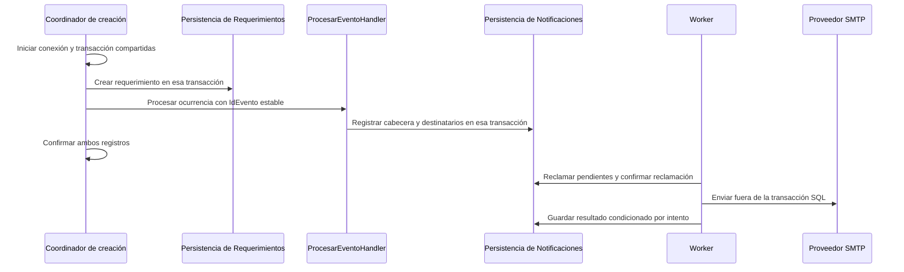
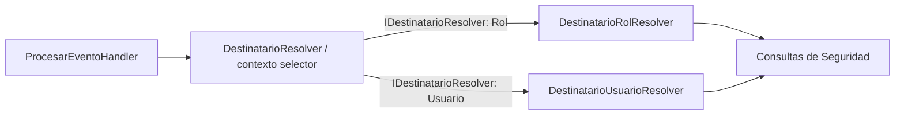

# Propuesta de implementación de Infrastructure — Módulo de Notificaciones

Fecha: 10 de noviembre de 2026.

Estado: propuesta técnica basada en las capas Domain y Application existentes. Este documento define el trabajo posterior; no acredita que los adaptadores, procedimientos, worker o integración con Requerimientos estén implementados.

## 1. Objetivo y alcance

Completar la infraestructura necesaria para generar, persistir, procesar y enviar notificaciones de correo del ERP, respetando las responsabilidades y garantías de los contratos actuales.

La implementación se organizará en este orden:

1. Persistencia y participación en transacciones.
2. Resolución de destinatarios y renderizado de plantillas.
3. Transporte SMTP.
4. Composición del módulo y procesamiento en segundo plano.
5. Integración transaccional con la creación de Requerimientos.

Cada etapa deberá quedar verificada antes de activar el envío automático. La última etapa implica cambios en el flujo emisor y se tratará como una integración separada.

No se propone incorporar inicialmente un intermediario de mensajes, otra tabla de eventos, una nueva política de reintentos ni un framework de casos de uso. Las tablas actuales pueden funcionar como cola transaccional de notificaciones cuando su registro comparta la transacción de negocio.

## 2. Base existente y límites actuales

Los antecedentes se encuentran en los reportes de [Domain](reporte-dominio-notificaciones.md) y [Application](reporte-application-notificaciones.md).

| Componente | Base disponible |
| --- | --- |
| Modelo | Entidades, fábricas, reconstrucción e invariantes de notificaciones, destinatarios, reglas y plantillas. |
| Ciclo de vida | Estados `Pendiente`, `Procesando`, `Enviada` y `Error`; reintentos y finalización por fallo permanente. |
| Persistencia | Interfaces de configuración y notificaciones, registro idempotente y guardado condicionado por intento. |
| Application | Generación por evento, procesamiento de pendientes y recuperación por timeout. |
| Servicios externos | Contratos de resolución de destinatarios, renderizado y envío de correo independientes del proveedor. |
| Política inicial | Lote de 10, máximo de 3 intentos, espera de 5 minutos y timeout de procesamiento de 10 minutos. |
| SQL | Migraciones V3.0.0–V3.0.2, tablas del esquema `Notificaciones` y catálogo inicial de `REQUERIMIENTO_CREADO`. |

Estos componentes no sustituyen la implementación de repositorios ni demuestran sus garantías bajo concurrencia real. La revisión de migraciones tampoco acredita su aplicación en una base objetivo.

Hay dos limitaciones relevantes para planificar la integración:

- `RequerimientoRepository.CrearAsync` abre y dispone su propia conexión. El flujo actual no proporciona directamente una transacción compartida con el registro de la notificación.
- El timeout empieza cuando se reclama el lote. Las últimas notificaciones de un lote secuencial consumen parte de ese tiempo esperando los envíos anteriores.

## 3. Estructura propuesta

```text
Notificaciones/
├── NotificacionesModule.cs
├── Application/
│   └── Services/
│       ├── IDestinatarioResolver.cs
│       └── DestinatarioResolver.cs
└── Infrastructure/
    ├── Persistence/
    │   ├── Repository/
    │   │   ├── NotificacionRepository.cs
    │   │   └── ConfiguracionNotificacionRepository.cs
    │   ├── Entity/
    │   └── Mapper/
    ├── Destinatarios/
    │   ├── DestinatarioRolResolver.cs
    │   └── DestinatarioUsuarioResolver.cs
    ├── Plantillas/
    │   └── PlantillaRenderer.cs
    ├── Email/
    │   ├── SmtpEmailSender.cs
    │   └── SmtpOptions.cs
    └── BackgroundJobs/
        ├── NotificacionesWorker.cs
        └── NotificacionesWorkerOptions.cs
```

Los nombres de tipos nuevos son propuestos. Las entidades de persistencia y mappers se crearán cuando aporten una traducción concreta entre SQL y Domain, siguiendo el patrón existente; no se generarán archivos vacíos para completar carpetas.

La dependencia seguirá esta dirección: Infrastructure implementa interfaces de Domain y Application. No se introducirán tipos Dapper, MailKit, MimeKit ni conexiones SQL en las entidades del dominio o en los comandos de eventos.

El mecanismo que permita compartir conexión y transacción deberá ubicarse en la infraestructura común si participa más de un módulo. Su contrato y composición se resolverán antes de modificar el flujo emisor, sin convertirlo en una refactorización general del ERP.

## 4. Persistencia con Dapper y SQL Server

### 4.1. Registro de notificaciones

`NotificacionRepository` implementará el contrato existente de [INotificacionRepository](../Cobranzas_Vittoria/Notificaciones/Domain/Persistence/INotificacionRepository.cs).

`RegistrarSiNoExisteAsync` deberá registrar cabecera y destinatarios en una sola operación transaccional. Si existe el mismo `IdEvento`, devolverá su ID con `Creada = false`, sin modificar contenido, destinatarios, estado ni intentos.

La estrategia SQL deberá proteger también la carrera entre dos registros concurrentes del mismo GUID. La restricción única seguirá siendo la garantía final. No bastará un `IF NOT EXISTS` sin protección de concurrencia ni se convertirán indiscriminadamente todos los errores de unicidad en una entrega duplicada.

El diseño del procedimiento deberá considerar las transacciones externas: un duplicado normal no debe dejar inutilizable la transacción del emisor. Se verificará este comportamiento con transacciones reales y concurrencia, incluyendo la configuración de manejo de errores SQL.

Los destinatarios se enviarán mediante parámetros estructurados o una operación equivalente parametrizada; se evitarán inserciones construidas mediante concatenación de texto. Si se requieren tipos tabla, se incorporarán en una migración nueva.

### 4.2. Reclamación atómica

`ReclamarPendientesAsync` deberá seleccionar un conjunto acotado y ordenado de notificaciones elegibles y actualizarlo atómicamente:

- Estado de `PENDIENTE` a `PROCESANDO`.
- Incremento de `Intentos` exactamente una vez.
- Asignación de `FechaInicioProcesamiento` con el instante UTC recibido.
- Limpieza de `FechaProximoIntento`.
- Retorno de las filas realmente reclamadas y sus destinatarios originales.

Se propone una actualización sobre un conjunto limitado, utilizando `OUTPUT` para identificar las filas afectadas. La transacción deberá confirmarse antes de devolver trabajo al handler y antes de cualquier comunicación SMTP.

Se evaluarán `UPDLOCK` y `READPAST` para coordinar consumidores. La selección definitiva de hints requiere verificar el aislamiento de la base objetivo: `READPAST` tiene restricciones con `READ_COMMITTED_SNAPSHOT` y omite bloqueos de fila, pero no todos los bloqueos de página. El diseño deberá probarse con la configuración real, sin asumir que una combinación de hints garantiza ausencia de bloqueos. Véase [Table hints de SQL Server](https://learn.microsoft.com/en-us/sql/t-sql/queries/hints-transact-sql-table?view=sql-server-ver17).

No se utilizará `NOLOCK` para decidir qué filas procesar. Application continuará recibiendo entidades que ya representan un intento iniciado.

### 4.3. Guardado condicionado

`GuardarResultadoAsync` comprobará que la entidad corresponde al intento recibido y aplicará una actualización condicionada por:

```text
IdNotificacion = identificador esperado
Estado actual = PROCESANDO
Intentos actuales = intento esperado
```

Solo admitirá los estados de resultado previstos por el contrato: `PENDIENTE`, `ENVIADA` y `ERROR`.

Actualizará el resultado y sus fechas, conservando contenido, destinatarios y contador de intentos. Si no se afecta ninguna fila, devolverá `false`; no ejecutará una actualización posterior sin condiciones ni forzará el estado recibido.

Este mecanismo protegerá tanto el envío como la recuperación de intentos interrumpidos.

### 4.4. Consulta de procesamientos vencidos

`ObtenerProcesamientosVencidosAsync` devolverá instantáneas de un lote en `PROCESANDO` con inicio estrictamente anterior al límite UTC. No modificará estado ni intentos, y no mantendrá bloqueos o transacciones abiertos después de retornar.

Application seguirá aplicando `RegistrarFallo` y guardando con el intento observado. La consulta SQL no agregará otra política de recuperación ni alterará filas por su cuenta.

### 4.5. Configuración y reconstrucción

`ConfiguracionNotificacionRepository` implementará todas las operaciones del contrato: consulta por evento y persistencia de regla e instrucciones, y de plantilla.

La lectura deberá distinguir evento inexistente, componentes ausentes y componentes desactivados. Se usarán relaciones y una estrategia de lectura consistente que eviten combinar partes de distintas actualizaciones concurrentes. Múltiples consultas dentro de una misma llamada Dapper no garantizan por sí solas una instantánea consistente.

Los guardados respetarán la unicidad por evento, la pertenencia de las instrucciones y las notificaciones ya generadas.

Los mappers utilizarán `Reconstruir` para conservar datos históricos. Traducirán explícitamente estados y tipos de envío SQL, sin asumir coincidencia entre identidades del catálogo y valores numéricos del enum `TipoDestinatario`.

Los campos SQL `datetime2` representan UTC por convención. El mapper deberá recuperar ese significado sin aplicar una conversión desde la zona local a datos que ya son UTC.

Los procedimientos y tipos nuevos se versionarán mediante migraciones posteriores. No se editarán V3.0.0–V3.0.2 para añadir la implementación pendiente.

## 5. Participación en la transacción del emisor

El flujo objetivo será:



El contexto compartido deberá hacer explícita la propiedad de conexión y transacción. Cuando el repositorio recibe recursos del emisor, no podrá confirmarlos, revertirlos ni disponerlos como si fueran propios. Cuando opere sin transacción externa, garantizará la atomicidad de su propia operación.

Para Requerimientos será necesario adaptar el camino de persistencia participante, porque actualmente abre su propia conexión. También deberá revisarse el procedimiento de creación y su manejo de transacciones antes de componerlo dentro de otra operación.

Una llamada al handler después de confirmar el requerimiento no garantiza atomicidad: puede quedar un requerimiento creado sin notificación si el proceso se interrumpe entre ambas operaciones.

Antes de activar esta integración deberá acordarse la política del negocio ante errores al generar la notificación. Con el modelo transaccional propuesto, un error propagado impide confirmar la operación completa; los resultados normales de omisión permiten continuar. Si se desea confirmar el requerimiento aun cuando falle la generación y recuperar esa generación después, hará falta diseñar otra persistencia durable de la ocurrencia, fuera de esta propuesta inicial.

## 6. Resolución de destinatarios

### 6.1. Contrato Strategy, implementaciones y contexto

El patrón Strategy utilizará directamente [IDestinatarioResolver](../Cobranzas_Vittoria/Notificaciones/Application/Services/IDestinatarioResolver.cs), definido en Application, como contrato de las estrategias. Infrastructure aportará dos implementaciones de esa misma interfaz: una por cada tipo de destinatario.

`DestinatarioResolver` será la fachada de resolución y el contexto selector del patrón. Recibirá las estrategias, seleccionará la correspondiente a la instrucción y delegará la operación. No implementará `IDestinatarioResolver` ni consultará usuarios o roles directamente.

| Componente | Responsabilidad |
| --- | --- |
| `IDestinatarioResolver` | Contrato Strategy en Application, compartido por las dos implementaciones. |
| `DestinatarioRolResolver : IDestinatarioResolver` | Estrategia en Infrastructure que consulta los usuarios del rol configurado. |
| `DestinatarioUsuarioResolver : IDestinatarioResolver` | Estrategia en Infrastructure que consulta el usuario configurado. |
| `DestinatarioResolver` | Fachada/contexto en Application que selecciona una estrategia según `ReglaDestinatario.TipoDestinatario` y delega. |

Las estrategias iniciales serán únicamente:

| Tipo del dominio | Implementación |
| --- | --- |
| `TipoDestinatario.Rol` (`ROL` en el catálogo) | `DestinatarioRolResolver`. |
| `TipoDestinatario.Usuario` (`USUARIO` en el catálogo) | `DestinatarioUsuarioResolver`. |

Para que cada estrategia declare qué tipo resuelve, se propone agregar la propiedad `Tipo` al contrato existente y conservar su método asíncrono:

```csharp
public interface IDestinatarioResolver
{
    TipoDestinatario Tipo { get; }

    Task<IReadOnlyCollection<DireccionCorreo>> ResolverAsync(
        ReglaDestinatario instruccion,
        CancellationToken cancellationToken = default);
}
```

`ReglaDestinatario` y `TipoDestinatario` son tipos existentes de Domain; `DireccionCorreo` pertenece a Application. La propiedad es una ampliación propuesta: el contrato actual todavía contiene únicamente `ResolverAsync`. No se introduce una segunda interfaz para representar las mismas estrategias.

La fachada se ubicará en Application porque seleccionar y delegar no requiere acceso a SQL ni a tipos de Infrastructure. Así, `ProcesarEventoHandler` podrá consumir `DestinatarioResolver` sin depender de clases de Infrastructure. Las consultas concretas permanecerán en las dos estrategias de Infrastructure.

Esta propuesta requiere, al implementarse, agregar la propiedad al contrato, actualizar sus dobles de prueba y sustituir la dependencia directa actual del handler por la fachada. No modifica las reglas del dominio ni la deduplicación de Application. Estos cambios se documentan aquí y aún no se han aplicado al código.

### 6.2. Selección y composición

La fachada recibirá las estrategias mediante `IEnumerable<IDestinatarioResolver>` en su constructor y construirá un registro de solo lectura indexado por la propiedad `Tipo`.



El registro se construirá una vez por instancia y la selección no dependerá del orden de inyección. No se resolverán dependencias mediante `IServiceProvider` dentro de la fachada ni se usará reflexión para localizar implementaciones. La fachada no se registrará como otra estrategia de `IDestinatarioResolver`, evitando incluirla en su propia colección de dependencias.

Se aplicarán estas reglas de composición:

- Una sola estrategia por tipo. Un registro duplicado producirá un error de configuración al construir la fachada; no se elegirá silenciosamente la primera implementación.
- Los dos tipos actuales deberán contar con una estrategia registrada, comprobado mediante pruebas de composición.
- Si se solicita un tipo sin estrategia, se lanzará `TipoDestinatarioNoSoportadoException`. Una colección vacía se reservará para una búsqueda válida sin direcciones disponibles.
- El `CancellationToken` se propagará sin cambios a la estrategia y a sus consultas.

La incorporación de otros eventos que utilicen ROL o USUARIO no requerirá modificar la fachada. Incorporar una categoría de destinatario nueva sí exigirá revisar el enum del dominio, el catálogo y la comprobación explícita de tipos soportados que actualmente hace `ProcesarEventoHandler`, además de implementar y registrar la estrategia correspondiente. No se propone habilitar categorías nuevas solo insertando una fila SQL.

### 6.3. Consultas y responsabilidades compartidas

Se propone excluir usuarios inactivos y omitir usuarios sin correo. Esta selección deberá documentarse y confirmarse como política funcional al implementar el adaptador; no se inferirán filtros por proyecto ni por comprador.

Se utilizarán consultas específicas con una proyección mínima de identidad, nombre y correo, evitando cargar todos los usuarios para filtrarlos en memoria. El acceso a datos de Seguridad se encapsulará en una capacidad de consulta del módulo; no se duplicarán sus entidades completas en Notificaciones.

Las estrategias devolverán direcciones concretas y no asignarán TO, CC o BCC: esa participación procede de la instrucción y Application la aplicará al crear los destinatarios. Application mantendrá la validación mediante las fábricas del dominio y la deduplicación por dirección y tipo de envío. Ni la fachada ni las estrategias incorporarán otra precedencia entre TO, CC y BCC o lanzarán `NotificacionSinDestinatariosException` por una búsqueda individual vacía.

Las políticas comunes de consulta, como la selección acordada de usuarios habilitados, se concentrarán en la capacidad de lectura de Seguridad cuando corresponda. No se duplicarán validaciones del dominio en cada estrategia.

La regla inicial seguirá expresando rol 2 como TO y rol 6 como CC. Esos valores serán configuración persistida, sin condiciones especiales en el código del evento.

## 7. Renderizado seguro de plantillas

`PlantillaRenderer` implementará [IPlantillaRenderer](../Cobranzas_Vittoria/Notificaciones/Application/Services/IPlantillaRenderer.cs) con marcadores `{{Variable}}` y nombres sensibles a mayúsculas.

La primera versión admitirá marcadores en texto y en valores completos de atributos expresamente permitidos. Deberá distinguir esos contextos mediante una estrategia de análisis adecuada; un reemplazo global por expresión regular no será suficiente para validar dónde se inserta cada valor.

| Contexto | Tratamiento requerido |
| --- | --- |
| Asunto | Sustituir valores y rechazar CR/LF. |
| Texto HTML | Codificar los valores para que se representen como texto. |
| Atributo permitido | Exigir comillas y codificar el valor según el contexto. |
| `href` | Validar la URL, admitir inicialmente HTTP/HTTPS y codificarla para el atributo. |
| Scripts, estilos u otros contextos no soportados | Rechazar la plantilla o el uso del marcador mediante un error controlado. |
| Variable requerida ausente o nula | Lanzar `VariablePlantillaFaltanteException` antes del registro. |

No se admitirán variables con HTML crudo. La plantilla configurable deberá tener una política de contenido confiable o validación de estructura; codificar variables no sanea scripts o enlaces peligrosos escritos directamente en la plantilla.

El renderer procesará asunto y cuerpo con variables de cualquier evento. No contendrá una lista fija de las cinco variables de `REQUERIMIENTO_CREADO`. Las fechas y montos llegarán ya formateados por el emisor según la cultura deseada.

Los errores identificarán evento y variable cuando corresponda, sin incluir el contenido completo del correo ni valores sensibles.

## 8. Transporte SMTP

### 8.1. Adaptador y opciones

Se propone MailKit/MimeKit dentro de `SmtpEmailSender`, conservando [IEmailSender](../Cobranzas_Vittoria/Notificaciones/Application/Services/IEmailSender.cs) independiente de esas bibliotecas. La versión a incorporar se seleccionará y verificará al implementar, incluyendo compatibilidad con .NET 8 y revisión de dependencias.

`SmtpOptions` representará servidor, puerto, modo TLS, usuario, credencial, remitente, nombre visible y límites de tiempo. Se validará al iniciar el componente. Los secretos provendrán de la configuración segura del entorno y no se incluirán en el repositorio, ejemplos ni logs.

Los datos reales de conexión se obtendrán desde **Connect Devices** de la cuenta `notificaciones@vittoriainmobiliaria.com` en cPanel. No se asumirá el hostname, puerto ni modo TLS por el nombre del dominio. Véase [Email Accounts de cPanel](https://docs.cpanel.net/cpanel/email/email-accounts/).

Se exigirá cifrado y validación de certificado. Los destinatarios BCC deberán llegar al sobre SMTP sin exponerlos en los encabezados entregados a los demás destinatarios.

### 8.2. Aceptación, errores y cierre

La operación finalizará satisfactoriamente cuando el proveedor confirme la aceptación del mensaje completo. Esto no acredita entrega final al buzón.

| Situación | Tratamiento propuesto |
| --- | --- |
| Rechazo temporal de mensaje o destinatario | `EnvioCorreoException` con clasificación transitoria. |
| Rechazo permanente de mensaje o destinatario | `EnvioCorreoException` permanente, considerando el contexto del rechazo. |
| Desconexión con aceptación incierta | `EnvioCorreoException` con clasificación desconocida. |
| Configuración inválida, autenticación fallida o validación TLS fallida | Error operativo que no debe convertir automáticamente todas las notificaciones en fallos permanentes. Suspender nuevos reclamos y alertar mediante el control del worker. |
| Cancelación solicitada | Propagar la cancelación sin reclasificarla como rechazo SMTP. |
| Fallo de cierre después de aceptación confirmada | Registrar un diagnóstico seguro de cierre sin invalidar la aceptación ni provocar un reenvío. |

La clasificación utilizará códigos SMTP y fase de la operación; no dependerá de buscar palabras en el mensaje de la excepción. Las respuestas SMTP temporales y permanentes se describen en [RFC 5321](https://www.rfc-editor.org/rfc/rfc5321.html). MailKit distingue rechazos del remitente, destinatario y mensaje mediante [SmtpErrorCode](https://mimekit.net/docs/html/T_MailKit_Net_Smtp_SmtpErrorCode.htm).

El adaptador no tendrá un bucle interno de reenvíos: la política de intentos seguirá perteneciendo a Application. Tampoco compartirá un cliente SMTP mutable entre envíos concurrentes sin una estrategia explícita de uso y sincronización.

### 8.3. Destinatarios rechazados y resultado incierto

El contrato actual devuelve éxito o fallo para el mensaje completo, sin resultados por destinatario. Para la primera versión se propone abortar antes de transmitir el cuerpo si se rechaza un destinatario durante la negociación del sobre, evitando introducir aceptación parcial deliberada.

Esta política se verificará con el comportamiento concreto de MailKit y un servidor de pruebas. Una futura necesidad de entregar al subconjunto aceptado requerirá ampliar el resultado y la persistencia por destinatario; no debe simularse mediante un éxito global.

Una desconexión después de transmitir el mensaje pero antes de recibir la confirmación puede dejar el resultado incierto. El adaptador deberá reflejar esa incertidumbre. SMTP y la unicidad de `IdEvento` no proporcionan por sí solos entrega exactamente una vez.

## 9. Composición del módulo y worker

`NotificacionesModule` registrará explícitamente los repositorios, adaptadores, handlers, opciones y `TimeProvider.System`, siguiendo el patrón de composición de módulos del ERP. Las dos estrategias se registrarán bajo el contrato `IDestinatarioResolver`; la fachada se registrará por su tipo concreto:

```csharp
services.AddScoped<IDestinatarioResolver, DestinatarioRolResolver>();
services.AddScoped<IDestinatarioResolver, DestinatarioUsuarioResolver>();
services.AddScoped<DestinatarioResolver>();
```

La fachada recibirá ambas implementaciones mediante `IEnumerable<IDestinatarioResolver>`. El handler recibirá la fachada, por lo que no dependerá de cuál implementación devuelva una resolución singular de la interfaz en DI.

| Componente | Duración propuesta |
| --- | --- |
| Repositorios y contexto transaccional | Scoped. |
| Handlers de Application | Scoped. |
| Fachada de destinatarios y estrategias ROL/USUARIO | Scoped, igual que sus dependencias de consulta. |
| Adaptador SMTP | Scoped o transient, con propiedad clara de sus recursos. |
| Renderer sin estado mutable | Singleton si sus dependencias permiten esa duración. |
| Worker | Singleton alojado, creando ámbitos para resolver sus dependencias. |

El worker tendrá un ciclo inicial cada 30 segundos, con esta secuencia:

1. Comprobar que el procesamiento está habilitado y no suspendido por un error operativo conocido.
2. Crear el ámbito de ejecución.
3. Ejecutar recuperación de notificaciones interrumpidas.
4. Ejecutar procesamiento de pendientes.
5. Registrar métricas y esperar el siguiente ciclo respetando cancelación.

No se superpondrán ciclos dentro de una instancia. Si existen varias instancias, la coordinación efectiva se apoyará en SQL, no en un semáforo local. Ningún ámbito del worker mantendrá una transacción de negocio durante el envío.

El uso de ámbitos explícitos para dependencias scoped de un servicio alojado sigue la [guía de servicios scoped dentro de BackgroundService](https://learn.microsoft.com/en-us/dotnet/core/extensions/scoped-service).

`NotificacionesWorkerOptions` contendrá habilitación y frecuencia. Los parámetros de lote, intentos y timeout seguirán en las opciones actuales de Application. El control de fallos del ciclo no agregará nuevos intentos de envío por fuera de esos handlers.

La suspensión ante errores de credenciales o TLS deberá tener una condición explícita de reanudación, como corrección de configuración y reinicio o una verificación operativa controlada. No se descartarán las notificaciones reclamadas cuyo resultado no se pudo guardar; seguirán sujetas a recuperación.

## 10. Coordinación de tiempos y recuperación

Se propone conservar inicialmente el envío secuencial, con tiempos acotados por operación. Antes de usar un lote de 10 deberá verificarse que el tiempo total máximo de conexión, autenticación, envío y persistencia del lote cabe dentro del timeout, con margen.

El cálculo debe considerar el peor caso de todos los elementos del lote, no solo el tiempo de un mensaje. Si no cabe en los 10 minutos iniciales, deberá reducirse el lote o ajustar los tiempos y la configuración. No se agregará paralelismo únicamente para ocultar ese desajuste.

La recuperación seguirá la política existente:

- No recuperar antes de superar el timeout.
- No incrementar intentos al consultar ni recuperar.
- Reprogramar con el intervalo configurado si quedan intentos.
- Finalizar en `ERROR` si se agotaron.
- Guardar siempre con el intento observado.

Un resultado tardío del proveedor puede perder la concurrencia frente a la recuperación. En ese caso no debe sobrescribirse el estado persistido. Aun con esa protección, un reintento posterior puede duplicar una entrega ya aceptada antes de la interrupción.

## 11. Observabilidad y operación

Se registrarán identificadores de notificación, número de intento, duración, clasificación segura de error y conflictos de concurrencia. Se evitarán credenciales, direcciones, variables y contenido del mensaje, incluyendo su exposición accidental mediante excepciones originales del proveedor.

Las métricas iniciales propuestas son cantidad de pendientes, antigüedad del pendiente más antiguo, procesamientos vencidos, resultados guardados, aceptación por el proveedor, errores definitivos y conflictos. Un resultado guardado no equivale necesariamente a un correo aceptado: puede ser una reprogramación o un error.

No se añadirá en esta etapa una reactivación automática de notificaciones en `ERROR`. Una futura operación de reenvío manual requerirá un caso de uso y una decisión de negocio propios.

La ejecución deberá alojarse en un proceso que permanezca activo. Si se aloja junto con la API, se verificará que el entorno no suspenda el procesamiento cuando no recibe solicitudes HTTP.

## 12. Pruebas y criterios de aceptación

Se reutilizarán NUnit, Testcontainers y los patrones del proyecto. Las pruebas con SQL Server utilizarán bases desechables; no se ejecutarán reparaciones ni pruebas destructivas sobre una base real de negocio.

| Área | Verificación mínima |
| --- | --- |
| Registro | Inserción completa de cabecera y destinatarios; rollback si falla una parte. |
| Idempotencia | Dos registros concurrentes del mismo `IdEvento` dejan una sola notificación y devuelven el mismo ID. |
| Transacción externa | Confirmación y rollback conjunto; el repositorio no dispone ni confirma recursos del emisor. |
| Duplicados y transacción | Una reentrega normal no invalida la transacción externa. |
| Reclamación | Dos consumidores no reciben la misma fila para el mismo intento; incremento único y respeto de fechas de reintento. |
| Guardado | Rechazo de resultados de intentos anteriores o filas que ya salieron de `PROCESANDO`. |
| Recuperación | Respeto del límite temporal, agotamiento y carreras entre envío y recuperadores. |
| Configuración | Lectura consistente, componentes ausentes/desactivados y guardados sin apropiarse de instrucciones ajenas. |
| Reconstrucción | Estados, participaciones, IDs de catálogo y fechas UTC correctamente mapeados; conservación de instantáneas. |
| Fachada de destinatarios | Selección de la estrategia correcta sin invocar la otra, independencia del orden de registro, rechazo de tipos sin soporte, registros duplicados y propagación de cancelación/errores. |
| Estrategias de destinatarios | Varios usuarios por rol, usuario fijo, usuario sin correo, inactividad y ausencia de resultados; pruebas aisladas para cada estrategia. |
| Composición de destinatarios | Resolución de la fachada mediante DI con dos implementaciones de `IDestinatarioResolver`, una por cada tipo soportado, sin incluir la propia fachada en la colección; actualización del handler y sus dobles conservando la deduplicación existente. |
| Renderer | Variables de distintos eventos, ausentes/nulas, CR/LF, comillas, HTML inyectado, URL peligrosas y contextos no soportados. |
| SMTP | Confirmación, rechazo temporal/permanente, cancelación, timeout, resultado incierto y credenciales/configuración inválidas. |
| Varios destinatarios | Rechazo antes del cuerpo y ausencia de exposición de BCC. |
| Cierre SMTP | Un error después de aceptación confirmada no provoca un fallo de envío ni otro intento. |
| Worker | Ámbitos DI, cancelación, ciclos sin solapamiento, suspensión por fallo operativo y tiempos del lote. |

Las pruebas SMTP iniciales usarán un servidor controlado que permita simular respuestas y cortes de conexión. Las credenciales corporativas no serán necesarias para ejecutar la suite automatizada.

Después se realizará una validación separada en el entorno de despliegue: configuración real de cPanel, conectividad, TLS, autenticación, aceptación y recepción de mensajes de prueba autorizados. Esa validación no podrá sustituirse por una compilación correcta ni por un servidor SMTP simulado.

## 13. Plan de entregas

| Etapa | Entregable | Condición para continuar |
| --- | --- | --- |
| 1. Persistencia | Ambos repositorios, mapeo, procedimientos y migraciones nuevas; participación en transacciones. | Pruebas SQL de atomicidad, idempotencia, reclamación y concurrencia aprobadas. |
| 2. Destinatarios y plantillas | Fachada en Application y dos estrategias de `IDestinatarioResolver` en Infrastructure; ajuste del contrato y handler, más renderer limitado y seguro. | Pruebas de selección, composición DI, estrategias, consultas, política de usuarios y seguridad del renderizado aprobadas. |
| 3. SMTP | Adaptador MailKit, opciones, clasificación y tratamiento del cierre. | Pruebas de protocolo y resultados inciertos aprobadas. |
| 4. Worker y DI | Composición del módulo, ámbitos, frecuencia, cancelación y observabilidad. | Flujo completo validado en un entorno controlado, sin superposición ni transacciones durante SMTP. |
| 5. Requerimientos | Emisión de `REQUERIMIENTO_CREADO` con identidad estable y registro en la misma transacción. | Rollback conjunto probado y validación del entorno antes de habilitar envíos reales. |

El resultado de cada etapa incluirá archivos modificados, decisiones pendientes resueltas, comandos de validación y límites de la evidencia obtenida.

## 14. Decisiones que deberán cerrarse durante la implementación

- Propiedad y composición exactas del contexto transaccional compartido, y adaptación mínima del camino de creación de Requerimientos.
- Política de negocio ante fallos de generación: abortar la operación conjunta o diseñar posteriormente otra forma durable de recuperación del evento.
- Selección de usuarios inactivos y, si corresponde, tratamiento de roles inactivos según el modelo real de Seguridad.
- Aislamiento y hints SQL compatibles con la base objetivo, comprobados mediante pruebas concurrentes.
- Gramática y contextos permitidos de las plantillas, y mecanismo de análisis/validación utilizado.
- Versión de MailKit, datos SMTP reales, tiempos máximos y mecanismo de secretos del entorno.
- Mecanismo de suspensión y reanudación del worker ante errores operativos de configuración.

Estas decisiones no implican rehacer las capas existentes. Cualquier ampliación de contrato que resulte indispensable deberá justificarse por una necesidad concreta y acompañarse de pruebas.

## 15. Estado de validación de este documento

Para elaborar este reporte se revisaron los contratos y antecedentes locales del módulo y se documentó la propuesta discutida. Se verificaron sus seis enlaces locales, los delimitadores de bloques, la ausencia de espacios finales y el salto de línea final. `git diff --check` no reportó errores en los cambios rastreados.

Este trabajo documental no ejecuta compilación, pruebas, migraciones, consultas contra una base objetivo ni envíos SMTP. Los resultados históricos de las capas previas permanecen en sus reportes; no se presentan como validación de Infrastructure.
