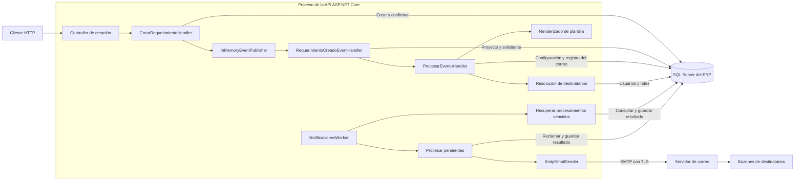
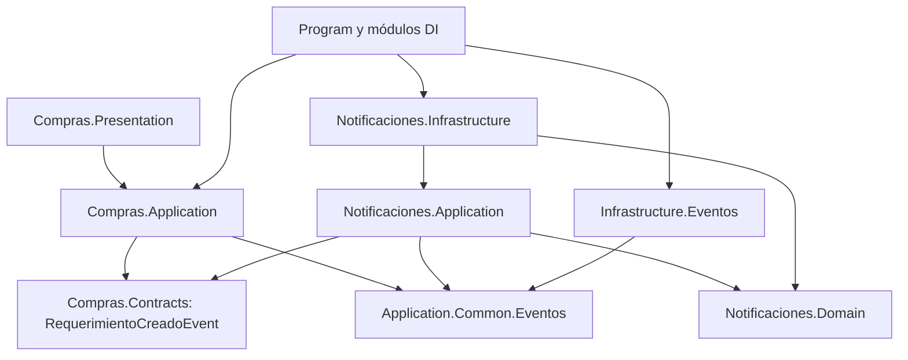
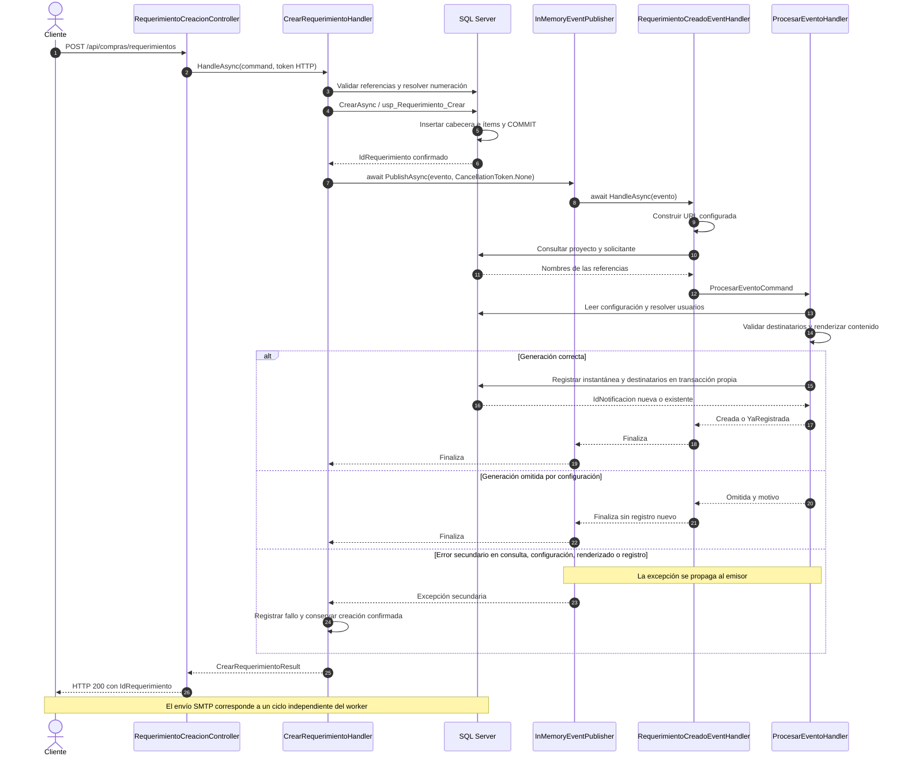
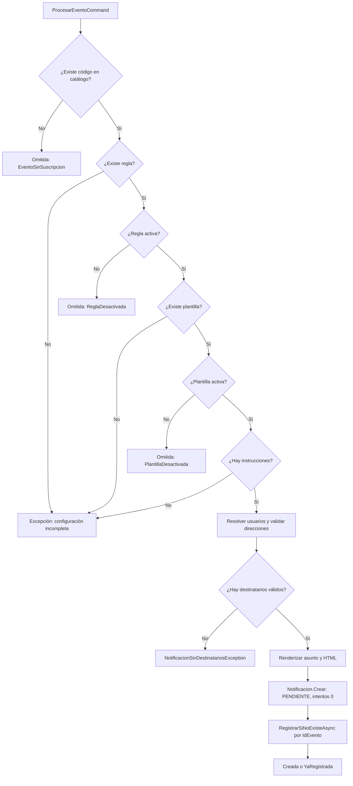
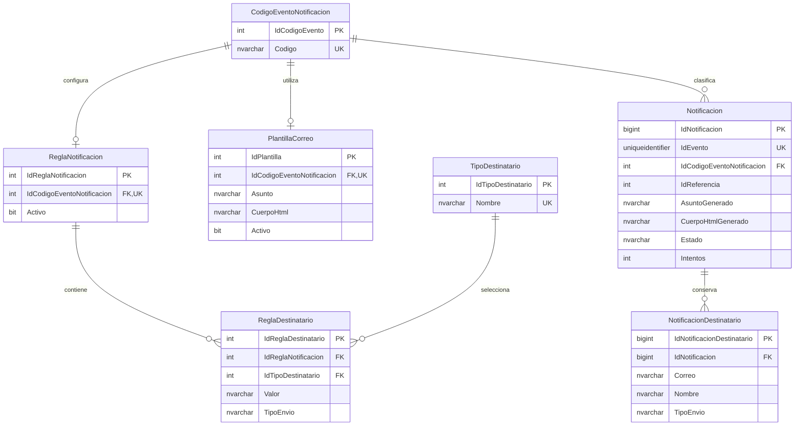
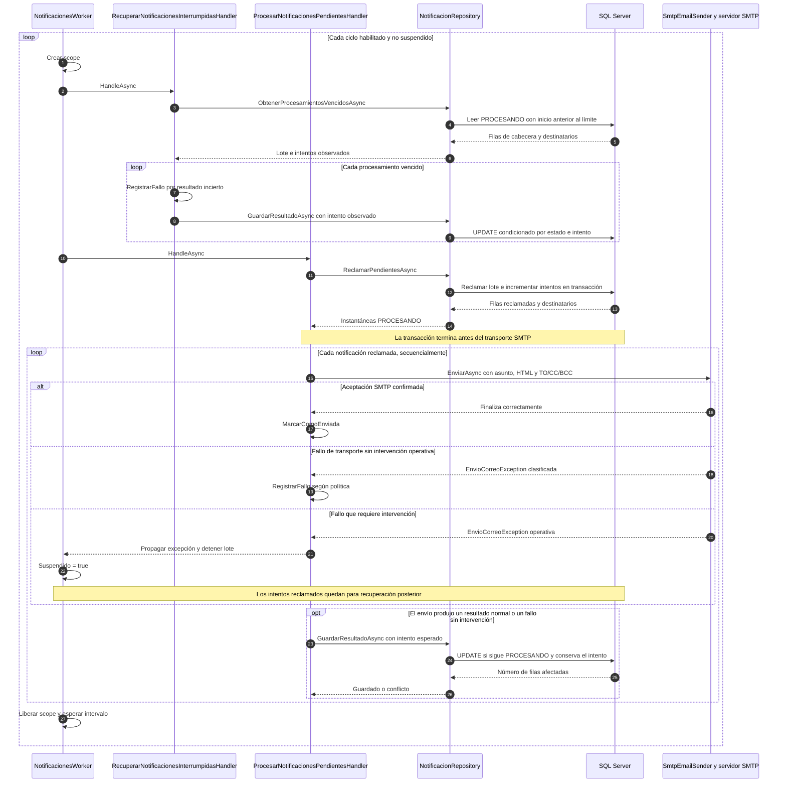
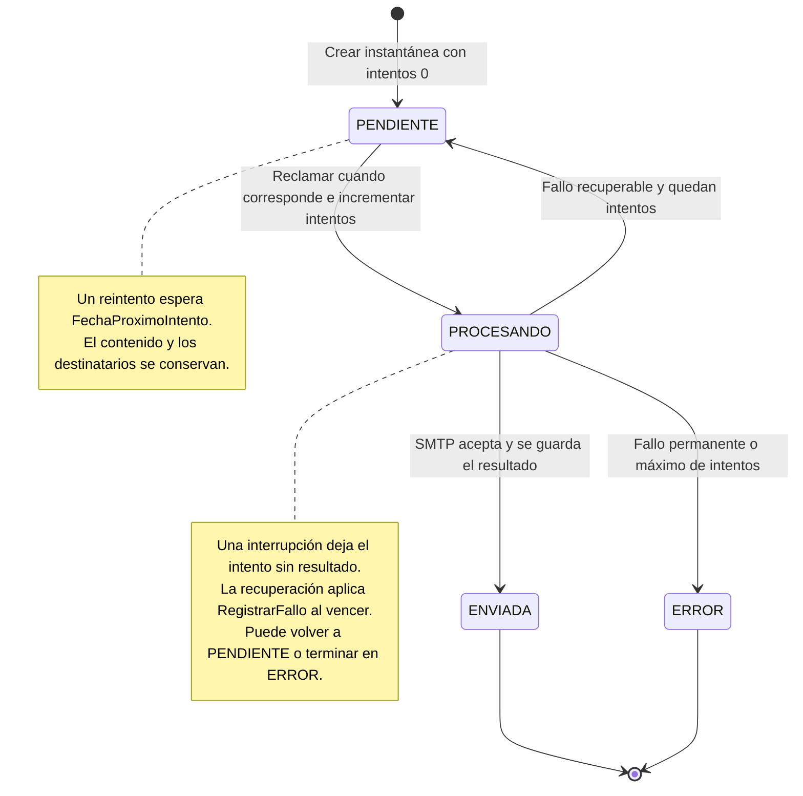
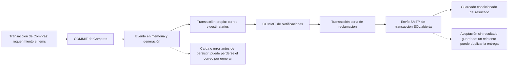

# Arquitectura y flujo completo del módulo de Notificaciones

Fecha de revisión: 12 de noviembre de 2026.

## 1. Propósito y alcance

El módulo transforma eventos de negocio en correos persistidos y coordina su envío con control de concurrencia, reintentos y recuperación. El ejemplo integrado actualmente es la creación de un requerimiento mediante `POST /api/compras/requerimientos`.

El flujo tiene dos etapas con tiempos y responsabilidades diferentes:

1. **Generación:** Compras confirma el requerimiento, publica un evento en memoria y espera a que Notificaciones intente registrar el correo y sus destinatarios.
2. **Entrega:** un worker alojado en la API reclama notificaciones persistidas y las envía por SMTP. Esta etapa se ejecuta de manera independiente de la solicitud HTTP.

El código de ambas etapas está implementado. Su ejecución efectiva depende de las migraciones, configuración, usuarios y servicios del entorno. En el archivo base de configuración el worker está deshabilitado.

Este reporte se basa en lectura del código actual, migraciones y pruebas existentes. No acredita ejecución en producción, aplicación de migraciones en una base destino ni recepción de correos corporativos. Las fuentes enlazadas son relativas a este documento.

## 2. Vista general de las conexiones

El sistema es un monolito modular: Compras y Notificaciones se ejecutan dentro del mismo proceso ASP.NET Core. El publicador distribuye eventos mediante llamadas a objetos del mismo proceso. La tabla de notificaciones conserva el trabajo pendiente de envío.



Hay tres conexiones principales:

| Conexión | Mecanismo real | Implicación |
| --- | --- | --- |
| Compras → Notificaciones | Contrato `RequerimientoCreadoEvent`, interfaces compartidas y publicador en memoria. | La distribución se espera con `await` y utiliza el scope del emisor. |
| Módulos → SQL Server | `IDbConnectionFactory`, `SqlConnectionFactory` y Dapper. | Se utiliza `ConnectionStrings:Default`; las operaciones abren conexiones propias y controlan sus transacciones. |
| Notificaciones → proveedor de correo | `IEmailSender` implementado por `SmtpEmailSender`, con MailKit/MimeKit. | Cada envío conecta, autentica, transmite y cierra su cliente SMTP. |

La consulta de proyecto/solicitante y los resolutores acceden directamente a proyecciones SQL de Compras, Maestra y Seguridad desde Infrastructure de Notificaciones. Existe, por tanto, una dependencia de integración con sus esquemas de datos, aunque Application no utiliza los repositorios concretos de esos módulos.

Fuentes: [publicador](../Cobranzas_Vittoria/Infrastructure/Eventos/InMemoryEventPublisher.cs), [fábrica SQL](../Cobranzas_Vittoria/Data/SqlConnectionFactory.cs), [consulta de referencias](../Cobranzas_Vittoria/Notificaciones/Infrastructure/Persistence/ConsultaRequerimientoCreado.cs) y [sender SMTP](../Cobranzas_Vittoria/Notificaciones/Infrastructure/Email/SmtpEmailSender.cs).

## 3. Capas, contratos y responsabilidades

### 3.1. Organización

```text
Cobranzas_Vittoria/
├── Application/Common/Eventos/       Interfaces compartidas de publicación y suscripción
├── Infrastructure/Eventos/           Distribución en memoria y registro DI
├── Compras/
│   ├── Contracts/Eventos/            Contrato público RequerimientoCreadoEvent
│   ├── Presentation/                 Endpoint y DTOs de creación
│   ├── Application/                  Caso de uso de creación
│   ├── Domain/                       Requerimiento, ítems y contratos de persistencia
│   └── Infrastructure/               Repositorio Dapper de Compras
└── Notificaciones/
    ├── NotificacionesModule.cs       Composición del módulo
    ├── Application/
    │   ├── RequerimientoCreado/      Adaptación del evento de Compras
    │   ├── ProcesarEvento/           Generación de la instantánea
    │   ├── ProcesarNotificacionesPendientes/
    │   ├── RecuperarNotificacionesInterrumpidas/
    │   ├── Services/                 Puertos de correo, renderizado y resolución
    │   └── Options/                  Enlaces y política de procesamiento
    ├── Domain/
    │   ├── Model/                    Modelos, invariantes y transiciones
    │   ├── Validator/                Validaciones de negocio
    │   ├── Exception/                Errores específicos
    │   └── Persistence/              Contratos de repositorios
    └── Infrastructure/
        ├── Persistence/              Repositorios SQL y consulta de referencias
        ├── Destinatarios/            Estrategias por rol y usuario
        ├── Plantillas/               Renderer HTML
        ├── Email/                    Adaptador SMTP y opciones
        └── BackgroundJobs/           Worker y opciones de ejecución
```

### 3.2. Dirección de dependencias

Este diagrama representa dependencias de código; las llamadas durante la ejecución aparecen en los diagramas de secuencia posteriores. Los módulos son carpetas dentro de la aplicación: la separación aquí descrita no implica ensamblados independientes.



| Componente | Responsabilidad |
| --- | --- |
| `RequerimientoCreacionController` | Recibir el HTTP, aplicar autorización, mapear el request e invocar el caso de uso. |
| `CrearRequerimientoHandler` | Validar y crear el requerimiento; publicar el evento después del commit y conservar el éxito de Compras si falla la fase secundaria. |
| `IEventPublisher` / `IEventHandler<TEvent>` | Expresar publicación y consumo sin acoplar los casos de uso al publicador concreto. |
| `RequerimientoCreadoEventHandler` | Traducir el contrato de Compras a las variables y al comando genérico de Notificaciones. |
| `ProcesarEventoHandler` | Evaluar configuración, resolver destinatarios, renderizar y persistir el correo. |
| Dominio de Notificaciones | Validar instrucciones, direcciones, contenido y transiciones del ciclo de vida. |
| Repositorios de Notificaciones | Reconstruir modelos y garantizar atomicidad, idempotencia y guardado condicionado por intento. |
| Handlers de procesamiento/recuperación | Aplicar la política de envío, reintentos y recuperación usando los puertos del módulo. |
| Infrastructure | Implementar SQL, resolución de usuarios, HTML, SMTP y ejecución periódica. |

El dominio conserva las reglas en sus modelos. Por ejemplo, `MarcarComoEnviada` y `RegistrarFallo` comprueban que el estado sea `Procesando` antes de modificarlo. Application coordina estas operaciones, mientras que Infrastructure implementa sus conexiones externas.

Fuentes: [contratos de eventos](../Cobranzas_Vittoria/Application/Common/Eventos), [contrato de Compras](../Cobranzas_Vittoria/Compras/Contracts/Eventos/RequerimientoCreadoEvent.cs), [dominio](../Cobranzas_Vittoria/Notificaciones/Domain) y [casos de uso](../Cobranzas_Vittoria/Notificaciones/Application).

## 4. Creación de requerimiento: desde HTTP hasta la notificación persistida

### 4.1. Entrada y confirmación de Compras

1. El cliente envía `POST /api/compras/requerimientos`. El endpoint exige `Permisos.Requerimientos.Crear` y recibe `CrearRequerimientoRequest`, con DataAnnotations para la entrada HTTP.
2. El request se transforma en `CrearRequerimientoCommand`. El solicitante efectivo se obtiene de `IUsuarioActualService`; el campo de usuario recibido en el DTO no decide la identidad de quien crea.
3. El handler valida entrada, proyecto, solicitante, materiales y partidas. Si la fecha de requerimiento viene por defecto, usa la fecha local obtenida de `TimeProvider`; esta decisión conserva el comportamiento de Compras y no fija una zona horaria nueva.
4. Resuelve la numeración y construye el agregado de requerimiento. Una colisión confirmada de número permite repetir la creación hasta cinco intentos; un timeout de persistencia no se reintenta como si acreditara rollback.
5. El repositorio modular llama a `compras.usp_Requerimiento_Crear` con los ítems mediante el TVP `compras.TVP_RequerimientoDetalle`.
6. En este camino el repositorio no pasa una transacción externa. El procedimiento confirma cabecera y detalle antes de devolver `IdRequerimiento`.

El punto que habilita la publicación es el retorno correcto de `CrearAsync`. Un error previo impide continuar hacia el evento.

Fuentes: [controller](../Cobranzas_Vittoria/Compras/Presentation/Controller/RequerimientoCreacionController.cs), [request](../Cobranzas_Vittoria/Compras/Presentation/Dto/CrearRequerimientoRequest.cs), [handler de creación](../Cobranzas_Vittoria/Compras/Application/Requerimiento/Crear/CrearRequerimientoHandler.cs), [repositorio modular](../Cobranzas_Vittoria/Compras/Infrastructure/Persistence/Repository/RequerimientoRepository.cs) y [procedimiento SQL](../Cobranzas_Vittoria/Migrations/Repeatable/2_StoredProcedures/R__Compras_SPs.sql).

### 4.2. Publicación y consumo del evento

Después del commit se crea `RequerimientoCreadoEvent`, con un GUID nuevo por ocurrencia, ID y número efectivos del requerimiento, fecha de negocio e instante UTC observado por la aplicación.

El handler ejecuta `await eventPublisher.PublishAsync(evento, CancellationToken.None)`. El token independiente permite continuar la generación si se cancela la solicitud HTTP después de confirmar Compras. La publicación sigue siendo esperada y añade su duración a la solicitud.

El publicador resuelve los `IEventHandler<RequerimientoCreadoEvent>` del scope actual y los invoca secuencialmente en orden de registro. Si alguno falla, detiene la distribución y propaga el error. Si no existen suscriptores, termina normalmente. No conserva los eventos ni programa reentregas.

El suscriptor de Notificaciones realiza estos pasos:

1. Construye la URL con `NotificacionEnlacesOptions`.
2. Consulta el proyecto y el solicitante del requerimiento confirmado.
3. Construye `ProcesarEventoCommand` con código `REQUERIMIENTO_CREADO`.
4. Espera a `ProcesarEventoHandler` y registra su resultado.

Las excepciones de esta etapa llegan al bloque de publicación de Compras, que registra identificadores y tipo de error y devuelve el resultado de creación. No vuelve a insertar el requerimiento ni revierte su commit.



La respuesta describe la creación del requerimiento. No incorpora un resultado de entrega de correo. Un cliente desconectado puede no recibir la respuesta aunque la creación ya esté confirmada.

Fuentes: [evento](../Cobranzas_Vittoria/Compras/Contracts/Eventos/RequerimientoCreadoEvent.cs), [publicador](../Cobranzas_Vittoria/Infrastructure/Eventos/InMemoryEventPublisher.cs), [suscriptor](../Cobranzas_Vittoria/Notificaciones/Application/RequerimientoCreado/RequerimientoCreadoEventHandler.cs) y [consulta SQL](../Cobranzas_Vittoria/Notificaciones/Infrastructure/Persistence/ConsultaRequerimientoCreado.cs).

## 5. Ejemplo de datos y construcción del correo

Los siguientes valores son ilustrativos y no proceden de una base real: requerimiento ID `4501`, número `1250`, proyecto `Obra de ejemplo`, solicitante `Ana Ejemplo` y fecha de requerimiento `12/11/2026`.

| Dato del comando | Origen | Valor ilustrativo |
| --- | --- | --- |
| `IdEvento` | GUID creado por Compras después de persistir. Se conserva durante toda la entrega del evento. | `9a1d5a40-7dd9-4f99-9c17-50b6dc3b6041` |
| `CodigoEvento` | Constante elegida por el suscriptor. | `REQUERIMIENTO_CREADO` |
| `IdReferencia` | `evento.IdRequerimiento`. | `4501` |
| `Variables["NumeroRequerimiento"]` | Número efectivo del evento. | `1250` |
| `Variables["Proyecto"]` | `maestra.Proyecto.NombreProyecto`. | `Obra de ejemplo` |
| `Variables["Solicitante"]` | Nombres y apellidos de `seguridad.Usuario`. | `Ana Ejemplo` |
| `Variables["Fecha"]` | Fecha del evento con formato `dd/MM/yyyy` y cultura invariable. | `12/11/2026` |
| `Variables["Url"]` | Base del frontend y ruta relativa configuradas. | `http://localhost:4200/requerimientos`, con la configuración de desarrollo incluida. |

`FechaOcurrenciaUtc` forma parte del evento, pero este suscriptor no la convierte en variable ni la pasa como fecha de creación de la notificación. `ProcesarEventoHandler` obtiene su propio instante UTC al construir la instantánea.

La plantilla inicial produce el asunto `Nuevo requerimiento: 1250` y un cuerpo con número, proyecto, solicitante, fecha y enlace. La URL construida dirige a la ruta configurada de requerimientos; este código no agrega el ID `4501` ni un parámetro para abrir un detalle específico.

### 5.1. Decisiones del generador



`EventoSinSuscripcion` es el nombre del motivo devuelto cuando el repositorio no encuentra el código del catálogo. Un evento existente sin regla o sin plantilla produce una excepción de configuración incompleta según el orden de evaluación anterior.

### 5.2. Resolución de destinatarios

La migración inicial establece:

| Estrategia | Valor de instrucción | Participación |
| --- | --- | --- |
| `ROL` | `2`, descrito por la migración como Almacenero. | `TO` |
| `ROL` | `6`, descrito como Coordinador de proyecto. | `CC` |

`DestinatarioResolver` selecciona una implementación de `IDestinatarioResolver` por `TipoDestinatario`. Actualmente existen estrategias `Rol` y `Usuario`. Los IDs numéricos del catálogo de tipos se interpretan por su nombre, sin asumir que coincidan con el enum.

La estrategia por rol consulta usuarios activos cuyo correo tenga contenido y que estén asociados al rol mediante `seguridad.UsuarioRol`. Si hay varios usuarios, devuelve todos. La estrategia por usuario aplica los mismos filtros al ID indicado.

**La consulta por rol no filtra por proyecto ni por estado del rol.** Por ello, la descripción “Coordinador de proyecto” del seed no equivale a resolver exclusivamente al coordinador del proyecto del requerimiento. Los IDs 2 y 6 pertenecen a la configuración SQL inicial y no están fijados dentro del resolver.

Application crea los destinatarios con la participación de cada instrucción. Descarta direcciones que el dominio reconoce como correo inválido y elimina duplicados por correo sin distinguir mayúsculas y por participación. Un correo puede conservar una participación TO y otra CC. Si no queda ninguna dirección válida, falla la generación.

### 5.3. Renderizado y conservación del contenido

`PlantillaRenderer` procesa el árbol HTML con HtmlAgilityPack. Sustituye variables de texto con codificación HTML y valida el enlace HTTP/HTTPS absoluto. Las variables en atributos solo se admiten como valor completo de un `href` de `a`. Rechaza estructura no admitida, variables ausentes o nulas y saltos de línea en el asunto. Los nombres de las variables distinguen mayúsculas.

Se guardan el asunto final, el HTML final y la lista final de destinatarios. El worker utiliza esa instantánea: cambios posteriores en usuarios, reglas o plantillas no recalculan un correo ya registrado. Desactivar una regla impide futuras generaciones evaluadas con esa configuración; las notificaciones existentes mantienen su ciclo de envío.

La configuración se lee con aislamiento `SERIALIZABLE`. La consulta de nombres, la lectura de configuración, la resolución de usuarios y el registro son operaciones distintas; no constituyen una transacción global del ERP.

Fuentes: [generador](../Cobranzas_Vittoria/Notificaciones/Application/ProcesarEvento/ProcesarEventoHandler.cs), [resultados](../Cobranzas_Vittoria/Notificaciones/Application/ProcesarEvento/ProcesarEventoResult.cs), [fachada de resolución](../Cobranzas_Vittoria/Notificaciones/Application/Services/DestinatarioResolver.cs), [resolver por rol](../Cobranzas_Vittoria/Notificaciones/Infrastructure/Destinatarios/DestinatarioRolResolver.cs), [resolver por usuario](../Cobranzas_Vittoria/Notificaciones/Infrastructure/Destinatarios/DestinatarioUsuarioResolver.cs), [renderer](../Cobranzas_Vittoria/Notificaciones/Infrastructure/Plantillas/PlantillaRenderer.cs) y [seed inicial](../Cobranzas_Vittoria/Migrations/Versioned/V3_0_2__Notificaciones_CatalogoInicialRequerimientoCreado.sql).

## 6. Persistencia y modelo de datos

Las migraciones V3.0.0, V3.0.1 y V3.0.2 definen el esquema, las siete tablas y la configuración inicial de `REQUERIMIENTO_CREADO`.

En el siguiente diagrama todas las entidades pertenecen al esquema `Notificaciones`. Se muestran las claves y campos que explican sus relaciones, sin enumerar todas las columnas.



La cardinalidad del diagrama representa restricciones de las tablas: SQL admite una cabecera sin filas de destinatarios. El flujo de alta del dominio exige destinatarios y el repositorio guarda cabecera y colección en una transacción única.

Conviene distinguir las identidades:

| Campo | Significado |
| --- | --- |
| `CodigoEvento` / `Codigo` | Nombre funcional, por ejemplo `REQUERIMIENTO_CREADO`. |
| `IdCodigoEventoNotificacion` | Referencia al catálogo; apunta a su PK `IdCodigoEvento`. |
| `IdEvento` | GUID de una ocurrencia concreta. Tiene restricción única y controla la idempotencia del registro. |
| `IdReferencia` | ID del registro de negocio; en el ejemplo, el requerimiento `4501`. No tiene FK a Compras. |
| `IdNotificacion` | Identidad SQL de la cabecera generada. |

`RegistrarSiNoExisteAsync` usa una transacción `SERIALIZABLE` y consulta `IdEvento` con `UPDLOCK, HOLDLOCK`. Si ya existe, devuelve el ID existente sin modificar su contenido ni destinatarios. Si es nuevo, inserta toda la instantánea y confirma. Una excepción al insertar un destinatario revierte también la cabecera.

La comprobación de duplicado sucede al registrar, después de leer configuración, resolver destinatarios y renderizar. Reentregar una ocurrencia conservando el GUID evita una segunda fila cuando se alcanza ese paso; no evita necesariamente trabajo previo o errores nuevos de configuración.

El índice por estado/próximo intento apoya la búsqueda de pendientes y el índice por estado/inicio apoya la recuperación. Otro índice permite buscar por evento de catálogo y referencia. Las fechas de Notificaciones se manejan en UTC y el esquema usa `DATETIME2(0)`.

`ConfiguracionNotificacionRepository` también dispone de guardados de reglas/instrucciones y plantillas con transacciones propias. Dos guardados separados no forman una edición administrativa atómica conjunta. No existe una capa HTTP administrativa de Notificaciones en este módulo.

Fuentes: [migración de tablas](../Cobranzas_Vittoria/Migrations/Versioned/V3_0_1__Notificaciones_CreaTablas.sql), [repositorio de notificaciones](../Cobranzas_Vittoria/Notificaciones/Infrastructure/Persistence/Repository/NotificacionRepository.cs), [contrato de persistencia](../Cobranzas_Vittoria/Notificaciones/Domain/Persistence/INotificacionRepository.cs) y [repositorio de configuración](../Cobranzas_Vittoria/Notificaciones/Infrastructure/Persistence/Repository/ConfiguracionNotificacionRepository.cs).

## 7. Envío en segundo plano y recuperación

### 7.1. Ciclo del worker

`NotificacionesWorker` es un `BackgroundService` dentro de la API. Cuando está habilitado y no suspendido, crea un scope y ejecuta, en este orden:

1. `RecuperarNotificacionesInterrumpidasHandler`.
2. `ProcesarNotificacionesPendientesHandler`.
3. Registro de contadores del ciclo.
4. Espera del intervalo configurado después de terminar el ciclo.

Cada instancia realiza un ciclo a la vez. Si hay varias instancias de API, cada una puede tener su worker; la reclamación SQL coordina el trabajo concurrente.



El diagrama describe las ramas de un ciclo. La excepción operativa termina inmediatamente el lote; no se sigue enviando ni se guarda un resultado normal para ese intento.

### 7.2. Reclamación y concurrencia

El repositorio selecciona hasta `TamanoLote` pendientes cuya fecha de reintento sea nula o ya haya llegado, ordenadas por fecha de creación e ID. La selección y el cambio a `PROCESANDO` ocurren atómicamente mediante un `UPDATE` sobre la selección, con `UPDLOCK, READPAST, READCOMMITTEDLOCK`.

Al reclamar se incrementa `Intentos`, se fija `FechaInicioProcesamiento` y se limpia `FechaProximoIntento`. La transacción incluye la lectura de las instantáneas devueltas y termina antes del envío. El handler no vuelve a llamar a `IniciarProcesamiento`: el repositorio ya aplicó esa transición de forma atómica en SQL.

El guardado final solo tiene efecto si la fila continúa en `PROCESANDO` y `Intentos` coincide con el intento esperado. Devuelve `false` ante conflicto y preserva el resultado que ganó la concurrencia. No cambia asunto, HTML, destinatarios ni contador desde el resultado.

### 7.3. Transporte SMTP

El sender construye un mensaje MIME con asunto y cuerpo HTML. TO y CC se incluyen en sus encabezados; BCC participa exclusivamente en el sobre SMTP. Las direcciones del sobre se deduplican sin distinguir mayúsculas.

El transporte exige `StartTls` o `SslOnConnect`, conserva la validación de certificados y utiliza límites de operación, intento total y cierre. El sender realiza un intento; Application decide los reintentos. Un destinatario rechazado aborta antes de transmitir el cuerpo según el comportamiento utilizado de MailKit; no se implementa seguimiento de entrega por destinatario.

`ENVIADA` significa que el servidor SMTP aceptó el mensaje y el resultado se pudo persistir. No confirma entrega al buzón, lectura ni ausencia de rebotes posteriores. Un fallo de cierre después de una aceptación confirmada no convierte ese envío en un fallo.

Fuentes: [worker](../Cobranzas_Vittoria/Notificaciones/Infrastructure/BackgroundJobs/NotificacionesWorker.cs), [procesamiento](../Cobranzas_Vittoria/Notificaciones/Application/ProcesarNotificacionesPendientes/ProcesarNotificacionesPendientesHandler.cs), [recuperación](../Cobranzas_Vittoria/Notificaciones/Application/RecuperarNotificacionesInterrumpidas/RecuperarNotificacionesInterrumpidasHandler.cs), [repositorio](../Cobranzas_Vittoria/Notificaciones/Infrastructure/Persistence/Repository/NotificacionRepository.cs) y [SMTP](../Cobranzas_Vittoria/Notificaciones/Infrastructure/Email/SmtpEmailSender.cs).

## 8. Estados, errores y reintentos



| Situación | Resultado |
| --- | --- |
| Validación o escritura de Compras falla antes del retorno correcto | No se publica el evento. Los errores del camino HTTP se propagan hacia el middleware de la API. |
| URL, referencias, configuración, destinatarios, plantilla o registro fallan después del commit | Compras registra el fallo secundario y conserva la creación; no hay reintento automático de generación. |
| Código ausente, regla desactivada o plantilla desactivada | El generador devuelve `Omitida` con motivo y no crea una instantánea nueva. |
| Fallo SMTP transitorio | Se vuelve a `PENDIENTE` con fecha futura si quedan intentos. |
| Fallo SMTP de clasificación desconocida | Se permite reintento si quedan intentos, aceptando la incertidumbre de una posible entrega anterior. |
| Fallo SMTP permanente del mensaje o destinatario | Se pasa a `ERROR`, aunque queden intentos disponibles. |
| Credenciales, certificado/TLS o remitente con fallo operativo | Se propaga `RequiereIntervencion`, el worker queda suspendido en memoria y no reclama ni recupera más trabajo en esa instancia. |
| Cancelación durante el procesamiento | No se convierte en rechazo SMTP; los intentos sin resultado pueden recuperarse después por timeout. |
| Guardado SQL falla después del envío | El intento puede permanecer en `PROCESANDO`; la recuperación posterior no puede saber con certeza si hubo entrega. |
| Resultado obsoleto por concurrencia | El guardado devuelve `false`; no sobrescribe un intento posterior ni un resultado ya guardado. |

La recuperación consulta procesamientos con inicio **estrictamente anterior** a `ahoraUtc - TimeoutProcesamientoMinutos`. Leerlos no incrementa intentos ni los modifica. Luego aplica `RegistrarFallo` con el intento observado y guarda condicionalmente.

Con la política inicial, un fallo recuperable programa el próximo intento cinco minutos después de registrar el fallo. Una recuperación tras diez minutos de procesamiento también aplica esa espera si corresponde reintentar. El siguiente envío depende, además, del siguiente ciclo y de la disponibilidad de la cola.

Para salir de una suspensión operativa se corrige la causa y se reinicia la API. La suspensión es local al proceso; no se comparte como estado global entre instancias. El reinicio no pone a cero los intentos ni reactiva automáticamente registros `ERROR`.

Fuentes: [modelo Notificacion](../Cobranzas_Vittoria/Notificaciones/Domain/Model/Notificacion.cs), [clasificación SMTP](../Cobranzas_Vittoria/Notificaciones/Infrastructure/Email/SmtpEmailSender.cs) y [excepción de transporte](../Cobranzas_Vittoria/Notificaciones/Domain/Exception/EnvioCorreoException.cs).

## 9. Fronteras transaccionales y garantías



Hay dos ventanas relevantes para entender el resultado del ejemplo:

1. **Entre el commit del requerimiento y el registro del correo:** el evento vive en memoria. Si el proceso cae o la generación falla, el requerimiento permanece creado y puede no existir ninguna notificación que el worker pueda recuperar. No hay Outbox ni reentrega persistida del evento.
2. **Entre la aceptación SMTP y el guardado de `ENVIADA`:** SQL y el proveedor no comparten transacción. Si se interrumpe el proceso o se pierde la confirmación, un reintento puede entregar otro correo.

La unicidad de `IdEvento` evita duplicar filas de notificación para la misma ocurrencia. No proporciona entrega exactamente una vez por SMTP ni idempotencia del endpoint de creación. Repetir un POST puede crear otro requerimiento y otro GUID si la operación vuelve a ser admitida.

El ciclo de recuperación opera sobre notificaciones ya persistidas en `PROCESANDO`; no reconstruye eventos perdidos a partir de requerimientos existentes.

## 10. Composición y configuración

### 10.1. Registro de dependencias

`Program.cs` registra `AddNotificaciones(builder.Configuration)`, `AddEventosEnMemoria()` y `AddCompras()`. Los módulos conectan los contratos con sus implementaciones:

| Contrato o servicio | Implementación / composición | Ciclo de vida |
| --- | --- | --- |
| `IEventPublisher` | `InMemoryEventPublisher`. | Scoped. |
| `IEventHandler<RequerimientoCreadoEvent>` | `RequerimientoCreadoEventHandler`. | Scoped. |
| `IConsultaRequerimientoCreado` | `ConsultaRequerimientoCreado`. | Scoped. |
| `INotificacionRepository` | `NotificacionRepository`. | Scoped. |
| `IConfiguracionNotificacionRepository` | `ConfiguracionNotificacionRepository`. | Scoped. |
| `IDestinatarioResolver` | Estrategias de rol y usuario; la fachada recibe la colección. | Scoped. |
| `IPlantillaRenderer` | `PlantillaRenderer`. | Singleton. |
| `IEmailSender` | `SmtpEmailSender`. | Scoped. |
| Handlers de generación, procesamiento y recuperación | Registrados explícitamente. | Scoped. |
| `TimeProvider` | `TimeProvider.System`, registrado mediante `TryAddSingleton`. | Singleton. |
| `NotificacionesWorker` | Servicio alojado que crea scopes por ciclo. | Singleton alojado. |

### 10.2. Valores incluidos y requisitos del entorno

| Sección | Propiedad | Valor incluido o predeterminado |
| --- | --- | --- |
| `Notificaciones:Enlaces` | `UrlBaseFrontend` | Vacío en base; `http://localhost:4200` en Development. |
| `Notificaciones:Enlaces` | `RutaRequerimientos` | `requerimientos`. |
| `Notificaciones:Worker` | `Habilitado` | `false`. |
| `Notificaciones:Worker` | `IntervaloSegundos` | `30` después de terminar el ciclo. |
| `Notificaciones:Procesamiento` | `TamanoLote` | `3`. |
| `Notificaciones:Procesamiento` | `MaximoIntentos` | `3` intentos totales. |
| `Notificaciones:Procesamiento` | `IntervaloReintentoMinutos` | `5`. |
| `Notificaciones:Procesamiento` | `TimeoutProcesamientoMinutos` | `10`. |
| `Notificaciones:Smtp` | `Host`, `Usuario`, `Contrasena` | Vacíos por defecto en `SmtpOptions`; requieren configuración externa para enviar. |
| `Notificaciones:Smtp` | `Puerto`, `ModoTls` | `587`, `StartTls`. |
| `Notificaciones:Smtp` | `Remitente` | `notificaciones@vittoriainmobiliaria.com`. |
| `Notificaciones:Smtp` | `NombreVisible` | `Notificaciones Vittoria`. |
| `Notificaciones:Smtp` | Timeouts de operación, total y cierre | `30`, `60` y `5` segundos, respectivamente. |

Los valores predeterminados no acreditan la configuración real del servidor corporativo. Se pueden aportar secretos y ajustes mediante el proveedor de configuración del entorno; por ejemplo, `Notificaciones__Smtp__Host`, `Notificaciones__Smtp__Usuario` y `Notificaciones__Smtp__Contrasena`.

**Deshabilitar el worker detiene procesamiento y recuperación, pero el suscriptor permanece registrado.** La creación de requerimientos sigue intentando generar correos y puede acumular filas `PENDIENTE`. Requiere también una URL válida para llegar al registro; el valor base vacío provoca un fallo secundario si el entorno no lo sustituye.

Las opciones de procesamiento, worker y SMTP utilizan validación al iniciar. La comprobación de SMTP completo se exige cuando se habilita el worker; el sender también valida antes de enviar. La URL se valida al construir el enlace en el suscriptor, no mediante `ValidateOnStart`.

Al habilitar el worker se exige que el presupuesto del lote sea menor que el timeout de recuperación:

```text
(TimeoutTotalSegundos + TimeoutCierreSegundos + 30) × TamanoLote + 60
    < TimeoutProcesamientoMinutos × 60

Valores iniciales: (60 + 5 + 30) × 3 + 60 = 345 segundos < 600 segundos.
```

Esta validación reserva margen para persistencia y ciclo. No garantiza tiempos de infraestructura ante bloqueos o pausas del proceso. Las opciones se consumen mediante `IOptions`; los cambios operativos requieren reiniciar la API.

El arranque contiene la aplicación de migraciones versionadas y repetibles mediante DbUp. La presencia de esos scripts no verifica su estado en una base concreta. El alojamiento debe mantener vivo el proceso para que el worker pueda avanzar.

Fuentes: [Program](../Cobranzas_Vittoria/Program.cs), [composición de Notificaciones](../Cobranzas_Vittoria/Notificaciones/NotificacionesModule.cs), [composición de eventos](../Cobranzas_Vittoria/Infrastructure/Eventos/EventosModule.cs), [opciones de enlaces](../Cobranzas_Vittoria/Notificaciones/Application/Options/NotificacionEnlacesOptions.cs), [opciones de procesamiento](../Cobranzas_Vittoria/Notificaciones/Application/Options/NotificacionProcesamientoOptions.cs), [opciones SMTP](../Cobranzas_Vittoria/Notificaciones/Infrastructure/Email/SmtpOptions.cs), [configuración base](../Cobranzas_Vittoria/appsettings.json) y [configuración de desarrollo](../Cobranzas_Vittoria/appsettings.Development.json).

## 11. Trazabilidad y lectura operativa del ejemplo

Para seguir el requerimiento ilustrativo `4501`, las identidades permiten recorrer esta cadena:

```text
IdRequerimiento 4501
    → IdEvento registrado por la publicación y el suscriptor
    → Notificacion.IdReferencia = 4501 y código REQUERIMIENTO_CREADO
    → IdNotificacion e IdEvento de la instantánea
    → Estado, Intentos y fechas del procesamiento
    → Destinatarios conservados por IdNotificacion
```

El suscriptor registra `Creada`, `YaRegistrada` u `Omitida`, junto con motivo e IDs. Compras registra un fallo de publicación con el ID del requerimiento confirmado y el GUID. El procesamiento informa intento, estado, duración, guardado y conflicto de concurrencia. Los errores del proveedor se registran con clasificación o tipo seguro; no se vuelcan credenciales, direcciones, HTML ni mensajes completos de las excepciones SQL/SMTP en estos caminos.

| Observación | Interpretación dentro de este flujo |
| --- | --- |
| Requerimiento creado sin fila de notificación | Puede haber omisión por configuración, error de generación o pérdida antes del registro. Revisar el resultado del suscriptor y los logs de publicación. |
| `PENDIENTE`, intentos 0 | Correo registrado sin reclamación; comprobar activación del worker y disponibilidad del proceso. |
| `PENDIENTE`, intentos mayores que 0 | Hubo fallo o recuperación y puede existir una fecha futura de reintento. |
| `PROCESANDO` | Intento reclamado; puede estar enviándose o haber quedado interrumpido. Evaluar fecha de inicio y timeout. |
| `ENVIADA` | Aceptación SMTP persistida; la recepción final se comprueba por separado. |
| `ERROR` | Fallo permanente o máximo de intentos; el ciclo normal no vuelve a reclamarlo. |
| Worker suspendido | Requiere corregir la causa operativa y reiniciar esa instancia de API. |

El contador `Guardadas` de un lote incluye resultados de reintento y error persistidos; no equivale a correos aceptados. No hay un endpoint administrativo del módulo para consultar, reactivar o reenviar estas notificaciones.

## 12. Pruebas existentes y límites de esta revisión

Se inspeccionaron pruebas que expresan las siguientes garantías. Esta tabla describe su cobertura en código; no informa una ejecución nueva ni reutiliza conteos históricos como si fueran resultados de esta revisión.

| Área | Comportamientos cubiertos en las pruebas existentes | Fuente |
| --- | --- | --- |
| Creación de Compras | Publicación posterior al retorno de persistencia, espera de suscriptores, conservación del éxito ante fallo secundario y token independiente tras commit. | [CrearRequerimientoHandlerTests](../Cobranzas_Vittoria/Cobranzas_Vittoria.Tests/Unit/Compras/Application/CrearRequerimientoHandlerTests.cs) |
| Distribución en memoria | Orden secuencial, ausencia de suscriptores, propagación del primer fallo, cancelación y uso del scope emisor. | [InMemoryEventPublisherTests](../Cobranzas_Vittoria/Cobranzas_Vittoria.Tests/Unit/Common/InMemoryEventPublisherTests.cs) |
| Adaptación del evento | Mapeo de variables, GUID estable en reentregas, URL y propagación de errores. | [RequerimientoCreadoEventHandlerTests](../Cobranzas_Vittoria/Cobranzas_Vittoria.Tests/Unit/Notificaciones/Application/RequerimientoCreadoEventHandlerTests.cs) |
| Integración HTTP/Compras/Notificaciones | Visibilidad del commit desde otra conexión, contenido y destinatarios, fallo de registro sin reversión de Compras y validación sin publicación. | [EventosRequerimientoTests](../Cobranzas_Vittoria/Cobranzas_Vittoria.Tests/Integration/Compras/EventosRequerimientoTests.cs) |
| Persistencia real del módulo | Atomicidad, duplicados concurrentes, reclamación, resultados condicionados, recuperación y flujo aislado hasta SMTP local. | [NotificacionesPersistenceTests](../Cobranzas_Vittoria/Cobranzas_Vittoria.Tests/NotificacionesSql/NotificacionesPersistenceTests.cs) |
| Dominio, Application y adaptadores | Invariantes, generación, reintentos, worker, estrategias, renderer y SMTP con servidor de prueba. | [pruebas de Notificaciones](../Cobranzas_Vittoria/Cobranzas_Vittoria.Tests/Unit/Notificaciones) |

Para elaborar este documento se revisaron archivos y conexiones y se comprobó la estructura Markdown y la existencia de sus enlaces locales. No se ejecutaron la API, pruebas .NET, migraciones ni envíos de correo. Los diagramas representan el código inspeccionado; su renderizado depende de un visor con soporte Mermaid.

Los documentos previos de [dominio](reporte-dominio-notificaciones.md), [Application](reporte-application-notificaciones.md), [Infrastructure](reporte-infrastructure-notificaciones.md) e [integración por eventos](reporte-eventos-negocio-compras-notificaciones.md) describen etapas de implementación diferentes. Las menciones de componentes pendientes en los reportes anteriores deben leerse en su fecha: el publicador, el suscriptor y la conexión con la creación de requerimientos ya están presentes en el código revisado para este reporte.
