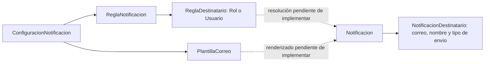
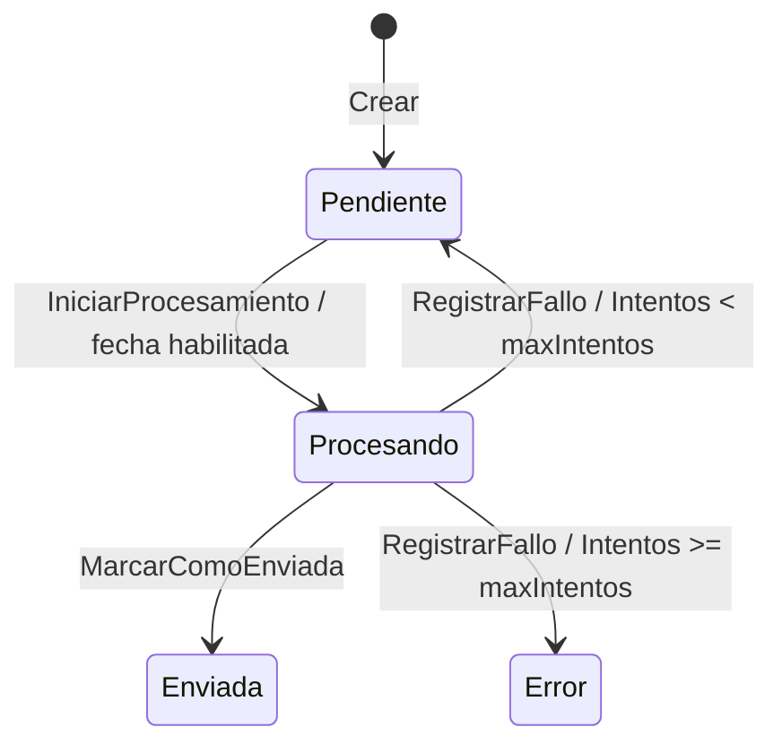

# Reporte del dominio implementado en Notificaciones

**Proyecto:** Sistema de Gastos Vittoria.

**Fecha de revisión:** 10 de noviembre de 2026.

**Referencia de código:** commit `384225a`, sin cambios locales previos a la elaboración del reporte.

**Ámbito principal:** [`Cobranzas_Vittoria/Notificaciones/Domain`](../Cobranzas_Vittoria/Notificaciones/Domain).

## 1. Estado y alcance

El nuevo módulo implementa el modelo de dominio para configurar notificaciones por evento de negocio, conservar el contenido y los destinatarios de cada correo generado, y controlar su procesamiento mediante estados e intentos. Las reglas se ejecutan en los modelos y en validadores internos dedicados.

La capa contiene **25 archivos C#**: siete de modelos y tipos, cinco validadores, diez excepciones y tres archivos de contratos y resultados de persistencia. Los modelos dependen de tipos de .NET y del propio dominio; no dependen de Dapper, SQL Server, ASP.NET Core ni de un proveedor de correo. Comparten el proyecto de la API: la separación actual es por carpetas y espacios de nombres, sin un ensamblado de dominio independiente.

| Área | Estado comprobado en el código |
| --- | --- |
| Modelos y reglas de negocio | Implementados. |
| Validadores de creación y modificación | Implementados como clases `internal static`. |
| Excepciones del módulo | Definidas; algunas ya son utilizadas por los modelos y validadores. |
| Persistencia | Dos interfaces y un resultado de registro; sin implementaciones concretas. |
| Pruebas unitarias del dominio | Tres clases, 58 casos ejecutados satisfactoriamente. |
| Base de datos | Existen tres migraciones SQL; se revisaron como contexto, sin ejecutarlas. |
| Flujo operativo de notificación | No hay capa `Application`, `Infrastructure` ni `Presentation` dentro del módulo revisado. Tampoco se encontraron consumidores del dominio fuera de sus pruebas. |

Las garantías descritas en las interfaces son obligaciones para sus futuros adaptadores. La presencia de un contrato o de una excepción no demuestra que exista el procesamiento que los utilizará.

## 2. Modelo de dominio

### 2.1. Identificación de un evento y de su notificación

El modelo distingue tres referencias:

| Dato | Tipo | Significado |
| --- | --- | --- |
| `IdEvento` | `Guid` | Identifica una ocurrencia concreta del evento. Es la clave prevista para el registro idempotente. |
| `IdCodigoEventoNotificacion` | `int` | Identifica el tipo de evento en el catálogo, por ejemplo, `REQUERIMIENTO_CREADO`. |
| `IdReferencia` | `int` | Identifica el registro de negocio que originó la notificación. |

El dominio no genera el `IdEvento`: lo recibe. Repetir una misma ocurrencia con un GUID distinto no queda cubierto por la idempotencia de registro. Tampoco se impone unicidad por la combinación de código de evento y referencia de negocio.

### 2.2. Entidades, tipos y responsabilidades

| Componente | Responsabilidad y comportamiento implementado |
| --- | --- |
| [`Notificacion`](../Cobranzas_Vittoria/Notificaciones/Domain/Model/Notificacion.cs) | Conserva identidad, referencia, asunto y HTML definitivos, destinatarios, estado, fechas, contador de intentos y último error. Expone `Crear`, `IniciarProcesamiento`, `MarcarComoEnviada`, `RegistrarFallo` y `Reconstruir`. |
| [`NotificacionDestinatario`](../Cobranzas_Vittoria/Notificaciones/Domain/Model/NotificacionDestinatario.cs) | Conserva correo, nombre opcional y participación de un destinatario concreto. Define `TipoEnvioConfig` con `To`, `Cc` y `Bcc`. Expone `Crear` y `Reconstruir`; no permite modificaciones públicas posteriores. |
| [`ReglaNotificacion`](../Cobranzas_Vittoria/Notificaciones/Domain/Model/ReglaNotificacion.cs) | Administra el nombre, la habilitación y las instrucciones de destinatarios de un evento. Permite crear, renombrar, agregar y quitar instrucciones, activar, desactivar y reconstruir. `PermiteNotificar()` devuelve su estado `Activo`. |
| [`ReglaDestinatario`](../Cobranzas_Vittoria/Notificaciones/Domain/Model/ReglaDestinatario.cs) | Representa una instrucción inmutable de resolución: tipo de catálogo, estrategia, valor y participación. No contiene direcciones resueltas ni realiza búsquedas de usuarios. |
| [`TipoDestinatario`](../Cobranzas_Vittoria/Notificaciones/Domain/Model/TipoDestinatario.cs) | Enumera las estrategias conocidas: únicamente `Rol` y `Usuario`. Sus valores numéricos no son los IDs del catálogo SQL. |
| [`PlantillaCorreo`](../Cobranzas_Vittoria/Notificaciones/Domain/Model/PlantillaCorreo.cs) | Almacena asunto y HTML configurables por evento, con activación y desactivación. Valida todo el contenido antes de actualizarlo. `PuedeUtilizarse()` devuelve `Activo`. No renderiza variables. |
| [`ConfiguracionNotificacion`](../Cobranzas_Vittoria/Notificaciones/Domain/Model/ConfiguracionNotificacion.cs) | `sealed record` de lectura conjunta: ID y código funcional del evento, regla opcional y plantilla opcional. Permite representar componentes ausentes o desactivados; no valida ni decide por sí mismo si se genera un correo. |

Las cinco entidades con identidad tienen constructor privado y propiedades con setters privados. Las altas se realizan mediante fábricas `Crear`. `Notificacion` administra sus destinatarios concretos y `ReglaNotificacion` administra sus instrucciones de destinatarios mediante colecciones de solo lectura hacia el consumidor.

### 2.3. Configuración frente a instantánea generada



Las flechas discontinuas representan responsabilidades de integración todavía no implementadas. `Notificacion.Crear` recibe el contenido ya generado y los destinatarios ya resueltos; no recibe una regla ni una plantilla para procesarlas.

La notificación guarda los textos definitivos y copia la colección de destinatarios. Estos destinatarios no tienen operaciones públicas de modificación. Cambiar una plantilla o la colección original suministrada al crear la notificación no altera esa instantánea. Desactivar una regla tampoco cancela notificaciones existentes: la regla no tiene una operación para modificarlas.

## 3. Validaciones e invariantes ejecutadas

### 3.1. Creación de una notificación

Fuente: [`NotificacionValidator`](../Cobranzas_Vittoria/Notificaciones/Domain/Validator/NotificacionValidator.cs).

| Entrada | Regla aplicada |
| --- | --- |
| `IdEvento` | Debe ser distinto de `Guid.Empty`. |
| Código de evento y referencia | Ambos IDs deben ser positivos. No se consulta su existencia en base de datos. |
| Asunto generado | Obligatorio, no puede contener solo espacios y admite hasta 250 caracteres. Se conserva sin recortar. |
| Cuerpo HTML generado | Obligatorio y no puede contener solo espacios. No se aplica un máximo de longitud ni se analiza el HTML. |
| Colección de destinatarios | No puede ser nula ni estar vacía; se copia a una colección de solo lectura. |
| Cada destinatario | Debe ser no nulo, tener ambos IDs en cero y superar nuevamente la validación de sus datos de envío. |
| Duplicados | Se rechaza el mismo correo con el mismo tipo de envío, comparando el correo sin distinguir mayúsculas. |

La misma dirección con participaciones diferentes, por ejemplo `To` y `Cc`, está permitida. No existe una exigencia de tener al menos un destinatario `To`: la condición implementada es disponer de al menos un destinatario válido.

Una alta válida queda en `Pendiente`, con `Intentos = 0`, fecha de creación suministrada por el consumidor y sin fechas de procesamiento, reintento o envío ni último error. La identidad de persistencia permanece en cero.

### 3.2. Creación de destinatarios concretos

Fuentes: `NotificacionDestinatario` y [`NotificacionDestinatarioValidator`](../Cobranzas_Vittoria/Notificaciones/Domain/Validator/NotificacionDestinatarioValidator.cs).

- El correo se recorta con `Trim()`; es obligatorio y admite hasta 254 caracteres después del recorte.
- Se utiliza `MailAddress.TryCreate` y se exige que la dirección interpretada coincida exactamente con el texto normalizado. Se rechazan listas de direcciones, nombres de presentación como `Nombre <correo>` y saltos de línea internos `CR` o `LF`.
- El nombre se recorta, admite hasta 150 caracteres y se convierte a `null` si está vacío o contiene solo espacios.
- El tipo de envío debe pertenecer al enum `To`, `Cc` o `Bcc`.
- La normalización no convierte el correo a minúsculas. La comparación sin distinguir mayúsculas se realiza al detectar duplicados dentro de la notificación.

La validación comprueba formato de dirección; no verifica existencia del buzón ni capacidad de entrega.

### 3.3. Configuración de reglas

Fuentes: `ReglaNotificacion` y [`ReglaNotificacionValidator`](../Cobranzas_Vittoria/Notificaciones/Domain/Validator/ReglaNotificacionValidator.cs).

- La regla se crea activa, asociada a un ID de evento positivo.
- El nombre se recorta y debe tener entre 1 y 150 caracteres, tanto al crear como al renombrar.
- Puede crearse y permanecer sin instrucciones de destinatarios. `PermiteNotificar()` solo comprueba `Activo`; no certifica que la configuración esté completa.
- `AgregarDestinatario` rechaza `null`, instrucciones con identidad o pertenencia persistida y configuraciones duplicadas.
- La igualdad de configuración considera estrategia, valor y participación, independientemente de los IDs de las filas.
- `QuitarDestinatario` elimina la instancia indicada; devuelve `false` cuando esa instancia no está en la colección. No busca por identidad persistida.
- Activar y desactivar cambia únicamente el indicador de la regla.

### 3.4. Instrucciones para resolver destinatarios

Fuentes: `ReglaDestinatario` y [`ReglaDestinatarioValidator`](../Cobranzas_Vittoria/Notificaciones/Domain/Validator/ReglaDestinatarioValidator.cs).

| Dato | Validación y normalización |
| --- | --- |
| `IdTipoDestinatario` | Positivo. El dominio no verifica su correspondencia con el enum; ambos deben provenir del mismo registro de catálogo. |
| Estrategia | Debe estar definida en `TipoDestinatario`: `Rol` o `Usuario`. |
| Participación | Debe estar definida en `TipoEnvioConfig`. |
| `Valor` | Se recorta, tiene un límite de 150 caracteres y, para las dos estrategias actuales, debe representar un entero positivo dentro del rango de `Int32`. |
| Representación del ID | Se convierte a su forma numérica canónica con cultura invariable: `" 002 "` se almacena como `"2"`. No se admiten signos ni formatos numéricos adicionales en un alta. |

Para detectar duplicados, también se reconoce como equivalente una referencia histórica reconstruida con ceros iniciales o espacios, sin modificar el texto histórico. El mismo rol o usuario puede configurarse con participaciones distintas.

El validador contiene una rama destinada a estrategias dinámicas sin valor fijo, pero el enum actual no define ninguna. Por tanto, no hay soporte operativo de dominio para `SOLICITANTE`, `RESPONSABLE_PROYECTO` u otras estrategias mencionadas como ejemplos en los comentarios SQL. Tampoco existen resolvedores de `Rol` o `Usuario` todavía.

### 3.5. Plantillas

Fuentes: `PlantillaCorreo` y [`PlantillaCorreoValidator`](../Cobranzas_Vittoria/Notificaciones/Domain/Validator/PlantillaCorreoValidator.cs).

- Se crean activas y requieren un ID de evento positivo.
- El asunto se recorta y debe tener entre 1 y 250 caracteres.
- El cuerpo HTML es obligatorio y no puede contener solo espacios; se conserva sin recortar.
- `ActualizarContenido` valida ambos textos antes de asignarlos. Un cuerpo inválido no deja actualizado parcialmente el asunto.
- La activación solo expresa disponibilidad para nuevas generaciones. El futuro caso de uso deberá consultar `PuedeUtilizarse()`.
- No se comprueban sintaxis de variables, valores suministrados, seguridad del HTML ni correspondencia entre los IDs de evento de una regla y una plantilla agrupadas en `ConfiguracionNotificacion`.

## 4. Ciclo de vida y reintentos

Fuente: `Notificacion.EstadoNotificacion` y sus métodos de transición.



| Operación | Precondiciones | Cambios realizados |
| --- | --- | --- |
| `IniciarProcesamiento(ahoraUtc)` | Estado `Pendiente`; sin reintento futuro pendiente. La igualdad con la fecha programada permite iniciar. | Pasa a `Procesando`, registra el inicio, limpia la fecha de próximo intento e incrementa `Intentos` una vez. Conserva el último error anterior. |
| `MarcarComoEnviada(fechaEnvioUtc)` | Estado `Procesando`. | Pasa a `Enviada`, registra el envío, limpia inicio de procesamiento, próximo intento y último error. Conserva el contador. |
| `RegistrarFallo(error, ahoraUtc, maxIntentos, intervaloReintento)` | Estado `Procesando`; motivo no vacío; máximo de intentos de al menos 1; intervalo positivo. | Guarda el error y limpia el inicio. Si se alcanzó el máximo, pasa a `Error` sin próximo intento. En caso contrario vuelve a `Pendiente` y programa `ahoraUtc + intervaloReintento`. No incrementa el contador. |

Solicitar una operación desde un estado no permitido produce `TransicionEstadoNotificacionInvalidaException`. Iniciar antes del reintento programado produce la validación `NOTIFICACION_REINTENTO_NO_DISPONIBLE`. Los rechazos de estado y las validaciones de fallo se comprueban antes de modificar los datos del intento.

El máximo y el intervalo se reciben en cada llamada a `RegistrarFallo`: **no hay una política fija de tres intentos y cinco minutos en el modelo**. Esos valores aparecen como sugerencia en la migración y como datos de algunas pruebas.

El modelo no recibe la clasificación `EsTransitorio` de un fallo de transporte. Su única decisión al registrar un fallo es comparar intentos con el máximo. No hay transición específica para fallo permanente, cancelación, reactivación desde `Error` ni recuperación de un procesamiento atascado. `Enviada` y `Error` no tienen transiciones de salida mediante los métodos de ciclo de vida existentes.

Los parámetros y comentarios establecen UTC como convención. Los métodos del modelo no verifican `DateTime.Kind`, no convierten zonas horarias y no validan el orden cronológico de las fechas. El consumidor debe suministrar instantes coherentes.

## 5. Reconstrucción y conservación histórica

Las entidades `Notificacion`, `NotificacionDestinatario`, `ReglaNotificacion`, `ReglaDestinatario` y `PlantillaCorreo` exponen una fábrica `Reconstruir` para recuperar datos persistidos.

Estas fábricas conservan identidades, textos, indicadores y estados tal como se reciben. No ejecutan las reglas de una alta nueva ni recortan o normalizan los textos. En `Notificacion` y `ReglaNotificacion` se exige una colección no nula y se copia su contenido; no se repiten las comprobaciones de duplicados, pertenencia o elementos válidos propias de la creación.

Esta separación permite preservar información histórica sin transformarla durante una lectura. También significa que la reconstrucción no certifica las invariantes de los datos suministrados: el adaptador deberá mapear correctamente los valores persistidos. Reconstruir una notificación en `Procesando` no incrementa intentos y permite continuar ese intento con los métodos habituales.

## 6. Contratos de persistencia

Todos los métodos son asíncronos y reciben `CancellationToken` opcional. El dominio define el comportamiento esperado; no contiene SQL ni implementaciones que lo hagan efectivo.

### 6.1. `INotificacionRepository`

Fuente: [`INotificacionRepository.cs`](../Cobranzas_Vittoria/Notificaciones/Domain/Persistence/INotificacionRepository.cs).

| Método | Obligaciones declaradas por el contrato |
| --- | --- |
| `RegistrarSiNoExisteAsync` | Registrar una notificación nueva y todos sus destinatarios en una transacción. Resolver duplicados y carreras mediante la unicidad SQL de `IdEvento`. Si ya existe, devolver su ID sin cambiar contenido ni destinatarios. |
| `ObtenerPorIdAsync` | Reconstruir la notificación con sus destinatarios originales. Devolver `null` cuando no exista. |
| `ReclamarPendientesAsync` | Reclamar hasta una cantidad positiva de pendientes cuyo reintento esté habilitado. Seleccionar y pasar a `PROCESANDO` atómicamente, incrementar intentos, fijar el inicio y limpiar el próximo intento. Exigir fecha UTC y devolver colección vacía si no hay trabajo. |
| `GuardarResultadoAsync` | Guardar únicamente resultados `PENDIENTE`, `ENVIADA` o `ERROR` del mismo intento. Actualizar solo si la fila sigue en `PROCESANDO` con `Intentos == intentoEsperado` y la entidad corresponde a ese intento. Devolver `false` ante pérdida de concurrencia. No modificar contenido o destinatarios ni sobrescribir el contador. |

[`ResultadoRegistroNotificacion`](../Cobranzas_Vittoria/Notificaciones/Domain/Persistence/ResultadoRegistroNotificacion.cs) es un `sealed record` con `IdNotificacion` y `Creada`: distingue una inserción de una ocurrencia ya registrada sin convertir la repetición en un error de negocio.

La reclamación devuelve entidades que ya representan un intento iniciado: el futuro worker no debe volver a llamar `IniciarProcesamiento`, pues contaría otro intento. Tampoco deberá mantener abierta la transacción de reclamación durante el envío de correo.

La idempotencia prevista evita duplicar el registro de una ocurrencia. No garantiza una única entrega al proveedor: una interrupción después del envío y antes de guardar el resultado puede permitir un nuevo envío. La coordinación de concurrencia descrita aún requiere un repositorio concreto y pruebas de integración.

### 6.2. `IConfiguracionNotificacionRepository`

Fuente: [`IConfiguracionNotificacionRepository.cs`](../Cobranzas_Vittoria/Notificaciones/Domain/Persistence/IConfiguracionNotificacionRepository.cs).

| Método | Obligaciones declaradas por el contrato |
| --- | --- |
| `ObtenerPorCodigoEventoAsync` | Devolver `null` si el evento no existe. Si existe, incluir configuración aun con regla o plantilla ausente o desactivada, y los destinatarios de la regla. Leer relaciones consistentemente para no mezclar versiones de una actualización concurrente. |
| `GuardarReglaAsync` | Insertar o actualizar regla e instrucciones en una transacción, conservar unicidad por evento y no reasignar instrucciones de otras reglas ni modificar notificaciones generadas. |
| `GuardarPlantillaAsync` | Insertar o actualizar conservando unicidad por evento y sin alterar correos ya generados. |

La aplicación deberá distinguir evento sin suscripción, configuración incompleta y desactivación deliberada. El record de configuración y las interfaces permiten expresar esas situaciones; no implementan la decisión de omitir o rechazar una generación.

## 7. Excepciones y códigos funcionales

### 7.1. Jerarquía disponible

[`NotificacionesException`](../Cobranzas_Vittoria/Notificaciones/Domain/Exception/NotificacionesException.cs) deriva de `System.Exception`, expone `CodigoError` y admite una causa original. Es la base común del módulo.

| Excepción | Base inmediata | Código o función |
| --- | --- | --- |
| [`ValidacionNegocioNotificacionException`](../Cobranzas_Vittoria/Notificaciones/Domain/Exception/ValidacionNegocioNotificacionException.cs) | `NotificacionesException` | Código recibido por constructor; expresa invariantes incumplidas. |
| [`NotificacionSinDestinatariosException`](../Cobranzas_Vittoria/Notificaciones/Domain/Exception/NotificacionSinDestinatariosException.cs) | `ValidacionNegocioNotificacionException` | `NOTIFICACION_SIN_DESTINATARIOS`. Admite código funcional de evento o ID de catálogo. |
| [`TransicionEstadoNotificacionInvalidaException`](../Cobranzas_Vittoria/Notificaciones/Domain/Exception/TransicionEstadoNotificacionInvalidaException.cs) | `ValidacionNegocioNotificacionException` | `NOTIFICACION_TRANSICION_ESTADO_INVALIDA`. |
| [`ConfiguracionNotificacionException`](../Cobranzas_Vittoria/Notificaciones/Domain/Exception/ConfiguracionNotificacionException.cs) | `NotificacionesException` | Base abstracta para errores de configuración. |
| [`ConfiguracionEventoIncompletaException`](../Cobranzas_Vittoria/Notificaciones/Domain/Exception/ConfiguracionEventoIncompletaException.cs) | `ConfiguracionNotificacionException` | `NOTIFICACION_CONFIGURACION_EVENTO_INCOMPLETA`. Identifica evento y componente faltante. |
| [`TipoDestinatarioNoSoportadoException`](../Cobranzas_Vittoria/Notificaciones/Domain/Exception/TipoDestinatarioNoSoportadoException.cs) | `ConfiguracionNotificacionException` | `NOTIFICACION_TIPO_DESTINATARIO_NO_SOPORTADO`. Prevista para un tipo sin resolvedor. |
| [`VariablePlantillaFaltanteException`](../Cobranzas_Vittoria/Notificaciones/Domain/Exception/VariablePlantillaFaltanteException.cs) | `ConfiguracionNotificacionException` | `NOTIFICACION_VARIABLE_PLANTILLA_FALTANTE`. Prevista para una variable requerida sin valor. |
| [`NotificacionNoEncontradaException`](../Cobranzas_Vittoria/Notificaciones/Domain/Exception/NotificacionNoEncontradaException.cs) | `NotificacionesException` | `NOTIFICACION_NO_ENCONTRADA`. Prevista para una consulta explícita por ID que requiere encontrar la entidad. |
| [`EnvioCorreoException`](../Cobranzas_Vittoria/Notificaciones/Domain/Exception/EnvioCorreoException.cs) | `NotificacionesException` | `NOTIFICACION_ENVIO_CORREO_FALLIDO`. Conserva causa original y clasificación `bool? EsTransitorio`: `true`, transitorio; `false`, permanente; `null`, desconocido. |

Los modelos y validadores ya lanzan validaciones de negocio, ausencia de destinatarios y transiciones inválidas. Las excepciones de configuración incompleta, tipo sin resolvedor, variable faltante, notificación inexistente y fallo de transporte están definidas para futuros consumidores; no se encontraron puntos que las lancen en el código productivo revisado.

### 7.2. Códigos de validación usados por los modelos

| Origen | Códigos |
| --- | --- |
| Creación de notificación | `NOTIFICACION_ID_EVENTO_REQUERIDO`, `NOTIFICACION_CODIGO_EVENTO_INVALIDO`, `NOTIFICACION_REFERENCIA_INVALIDA`, `NOTIFICACION_ASUNTO_INVALIDO`, `NOTIFICACION_CUERPO_REQUERIDO`. |
| Colección de destinatarios | `NOTIFICACION_DESTINATARIO_NO_NUEVO`, `NOTIFICACION_DESTINATARIO_DUPLICADO`, además de `NOTIFICACION_SIN_DESTINATARIOS`. |
| Datos del destinatario | `NOTIFICACION_DESTINATARIO_CORREO_INVALIDO`, `NOTIFICACION_DESTINATARIO_NOMBRE_INVALIDO`, `NOTIFICACION_DESTINATARIO_TIPO_ENVIO_INVALIDO`. |
| Procesamiento y fallos | `NOTIFICACION_REINTENTO_NO_DISPONIBLE`, `NOTIFICACION_MAXIMO_INTENTOS_INVALIDO`, `NOTIFICACION_INTERVALO_REINTENTO_INVALIDO`, `NOTIFICACION_MOTIVO_FALLO_REQUERIDO`, además del código de transición inválida. |
| Regla | `REGLA_NOTIFICACION_EVENTO_INVALIDO`, `REGLA_NOTIFICACION_NOMBRE_INVALIDO`, `REGLA_DESTINATARIO_YA_PERSISTIDO`, `REGLA_DESTINATARIO_DUPLICADO`. |
| Instrucción de destinatario | `REGLA_DESTINATARIO_TIPO_INVALIDO`, `REGLA_DESTINATARIO_ENVIO_INVALIDO`, `REGLA_DESTINATARIO_VALOR_INVALIDO`, `REGLA_DESTINATARIO_IDENTIFICADOR_INVALIDO`. |
| Plantilla | `PLANTILLA_CORREO_EVENTO_INVALIDO`, `PLANTILLA_CORREO_ASUNTO_INVALIDO`, `PLANTILLA_CORREO_CUERPO_REQUERIDO`. |

También está declarado `REGLA_DESTINATARIO_VALOR_NO_PERMITIDO` en la rama de estrategias dinámicas del validador; esa rama no se alcanza con los dos valores actualmente definidos en el enum.

Los argumentos nulos de ciertas operaciones, como agregar una instrucción o reconstruir una colección, producen `ArgumentNullException` mediante `ThrowIfNull`, en lugar de una excepción funcional del módulo.

### 7.3. Mensajes y manejo HTTP

Las validaciones de correo y nombre no interpolan los valores rechazados. Los comentarios de las excepciones establecen que los mensajes deben omitir credenciales, direcciones y contenido del correo. Sin embargo, `EnvioCorreoException` y `RegistrarFallo` aceptan texto proporcionado por el consumidor sin sanitizarlo; este deberá preparar mensajes adecuados y proteger la causa original del transporte.

El [`ApiExceptionMiddleware`](../Cobranzas_Vittoria/Middleware/ApiExceptionMiddleware.cs) actual no tiene un tratamiento específico de `NotificacionesException`. Si una de estas excepciones llegara sin otro manejo a la canalización HTTP, caería en el `catch (Exception)` general, con HTTP 500 y código `UNHANDLED_ERROR`. No hay todavía una traducción HTTP que preserve los códigos funcionales del módulo.

## 8. Correspondencia con las migraciones existentes

Las migraciones aportan contexto de persistencia, sin formar parte de la implementación C# del dominio:

| Migración | Contenido revisado |
| --- | --- |
| [`V3_0_0`](../Cobranzas_Vittoria/Migrations/Versioned/V3_0_0__Notificaciones_CreaSchema.sql) | Creación del esquema `Notificaciones`. |
| [`V3_0_1`](../Cobranzas_Vittoria/Migrations/Versioned/V3_0_1__Notificaciones_CreaTablas.sql) | Siete tablas: catálogo de eventos, reglas, catálogo de tipos de destinatario, instrucciones de regla, plantillas, notificaciones y destinatarios concretos. Incluye unicidad de `IdEvento`, una regla y una plantilla por evento, restricciones de estados y tipos de envío, e índices para consulta de pendientes y procesamientos. |
| [`V3_0_2`](../Cobranzas_Vittoria/Migrations/Versioned/V3_0_2__Notificaciones_CatalogoInicialRequerimientoCreado.sql) | Catálogo inicial `REQUERIMIENTO_CREADO`, tipos `ROL` y `USUARIO`, regla activa, rol `2` como `TO`, rol `6` como `CC` y plantilla activa con variables `NumeroRequerimiento`, `Proyecto`, `Solicitante`, `Fecha` y `Url`. |

Los nombres de los roles indicados en comentarios de la semilla no fueron contrastados con datos de una base objetivo. La semilla configura destinatarios por sus IDs de rol; no implementa su resolución ni limita por sí misma la búsqueda a un proyecto.

El adaptador deberá traducir `Pendiente`, `Procesando`, `Enviada` y `Error` a sus nombres SQL en mayúsculas, al igual que `To`, `Cc` y `Bcc`. Para `TipoDestinatario` deberá mapear los nombres del catálogo, sin asumir que los valores numéricos del enum coinciden con las identidades SQL. También deberá distinguir `IdCodigoEvento` del catálogo SQL y `IdCodigoEventoNotificacion` utilizado por el modelo y sus relaciones.

La revisión de los scripts no acredita que estén aplicados en desarrollo, otra computadora o producción. No se abrió una conexión a SQL Server ni se modificaron datos durante este reporte.

## 9. Pruebas y validación realizada

Se revisaron y ejecutaron las pruebas existentes en [`Unit/Notificaciones/Domain`](../Cobranzas_Vittoria/Cobranzas_Vittoria.Tests/Unit/Notificaciones/Domain).

| Clase | Casos ejecutados | Comportamientos comprobados |
| --- | ---: | --- |
| [`NotificacionTests`](../Cobranzas_Vittoria/Cobranzas_Vittoria.Tests/Unit/Notificaciones/Domain/NotificacionTests.cs) | 19 | Reintento en su fecha, incremento de intentos, limpieza al enviar, agotamiento, transiciones rechazadas, validación de fallos, asunto obligatorio y límites, ausencia y duplicación de destinatarios, rechazo de destinatarios persistidos, conservación de instantánea y reconstrucción. |
| [`NotificacionDestinatarioTests`](../Cobranzas_Vittoria/Cobranzas_Vittoria.Tests/Unit/Notificaciones/Domain/NotificacionDestinatarioTests.cs) | 21 | Correos malformados, listas y nombres de presentación, saltos de línea, ausencia de correo, normalización, nombre opcional, límites, enum de envío, mensajes que omiten datos rechazados y reconstrucción. |
| [`ConfiguracionNotificacionTests`](../Cobranzas_Vittoria/Cobranzas_Vittoria.Tests/Unit/Notificaciones/Domain/ConfiguracionNotificacionTests.cs) | 18 | Activación y desactivación, IDs de evento inválidos, actualización de plantilla sin cambios parciales, límites de nombre y asunto, valores de instrucciones, duplicados numéricamente equivalentes, pertenencia persistida, eliminación y reconstrucción. |
| **Total** | **58** | **58 aprobados, 0 fallidos.** |

Los conteos incluyen cada variante de `[TestCase]`. No equivalen a un porcentaje de cobertura de líneas o ramas.

Comando reproducible desde la raíz del backend, con dependencias previamente restauradas:

```bash
dotnet test Cobranzas_Vittoria/Cobranzas_Vittoria.Tests/Cobranzas_Vittoria.Tests.csproj \
  --no-restore \
  --filter FullyQualifiedName~Cobranzas_Vittoria.Tests.Unit.Notificaciones.Domain \
  --logger 'console;verbosity=normal' \
  --logger 'trx;LogFileName=notificaciones-dominio.trx' \
  --results-directory /tmp/vittoria-notificaciones-test-results
```

La primera ejecución compiló la API y el proyecto de pruebas, con advertencias en otros módulos, pero el sandbox bloqueó el socket local requerido por VSTest. Tras autorizar la ejecución fuera del sandbox, se repitió sobre esos binarios con `--no-build --no-restore`: los 58 casos pasaron. El resultado TRX quedó en `/tmp/vittoria-notificaciones-test-results/notificaciones-dominio.trx`, como evidencia temporal de esta revisión.

La validación acredita comportamiento unitario del dominio. No comprueba repositorios, carreras concurrentes reales, migraciones aplicadas, resolución de usuarios, renderizado, transporte de correo, endpoints desplegados ni entrega efectiva. No se ejecutó la suite completa del backend ni se generó una medición de cobertura.

## 10. Límites actuales y trabajo de integración pendiente

| Responsabilidad | Situación observada |
| --- | --- |
| Integración con eventos de negocio | El dominio recibe un ID y datos del evento; no existe publicador, suscriptor ni caso de uso que genere notificaciones desde Requerimientos. |
| Resolución de destinatarios | Existen instrucciones para `Rol` y `Usuario`; faltan consultas y resolvedores que produzcan correos concretos. |
| Renderizado de plantillas | Hay texto configurable y una excepción para variables faltantes; falta el renderizador y su validación de variables. |
| Persistencia transaccional e idempotente | Los contratos y las restricciones SQL están definidos; faltan adaptadores y pruebas con base de datos. |
| Concurrencia entre workers | El contrato especifica reclamación y guardado condicionado por intento; falta su ejecución atómica real. |
| Procesamiento en segundo plano | No existe worker, planificador ni política configurada de reintentos. |
| Transporte de correo | Existe `EnvioCorreoException`; falta el adaptador del proveedor y la decisión ante fallos permanentes o desconocidos. |
| Recuperación de intentos interrumpidos | Existe fecha de inicio e índice SQL asociado; no hay operación de dominio o repositorio para recuperación por timeout. |
| API y manejo de errores | No hay endpoints del módulo ni traducción HTTP específica de sus excepciones. |

El dominio implementado permite crear y preservar una notificación válida en memoria y controlar sus transiciones. Completar las responsabilidades de esta tabla será necesario para convertir esa base en un flujo automático de notificación por correo.
