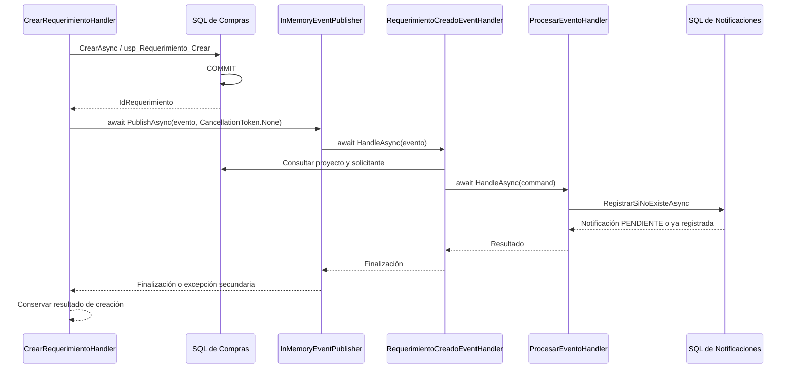

# Eventos de negocio en memoria: Compras y Notificaciones

Fecha: 11 de noviembre de 2026.

## 1. Resultado y arquitectura

La creación modular de requerimientos publica `RequerimientoCreadoEvent` después de confirmar Compras. Un suscriptor de Application de Notificaciones lo traduce a `ProcesarEventoCommand` y espera al caso de uso existente, que registra la instantánea `PENDIENTE` con sus destinatarios. El envío sigue a cargo del worker existente.

Se comprobaron **521 casos: 331 unitarios y 190 de integración, todos aprobados, sin fallos ni omisiones**. Incluyen 30 casos nuevos, seis de ellos añadidos a la suite existente de creación. Las pruebas SQL usaron contenedores aislados con SQL Server 2025; no se enviaron correos corporativos. La suite existente de transporte utiliza su propio servidor SMTP local de prueba.



Los contratos compartidos no dependen de Compras ni Notificaciones. Compras depende de su contrato público y `IEventPublisher`. Application de Notificaciones depende de ese contrato público, sus propios puertos y el publicador abstracto mediante `IEventHandler<TEvent>`. La consulta Dapper concreta queda en Infrastructure.

## 2. Inspección inicial y punto de confirmación

Se revisaron los módulos, las firmas reales de `ProcesarEventoCommand` y `ProcesarEventoHandler`, la configuración SQL V3.0.2, los modelos de Compras, DI, logging, los fixtures NUnit/Respawn/Testcontainers y la documentación anterior de Infrastructure de Notificaciones. No se encontró un publicador/suscriptor reutilizable existente.

El endpoint vigente es `POST /api/compras/requerimientos`, en `Compras/Presentation/Controller/RequerimientoCreacionController.cs`. Invoca `Compras/Application/Requerimiento/Crear/CrearRequerimientoHandler.cs`; su repositorio modular es `Compras/Infrastructure/Persistence/Repository/RequerimientoRepository.cs`.

`CrearAsync` abre una conexión propia y ejecuta `compras.usp_Requerimiento_Crear`, sin pasar una transacción externa. El procedimiento está en `Migrations/Repeatable/2_StoredProcedures/R__Compras_SPs.sql`: **línea 1114, `IF @TranCount = 0 COMMIT TRANSACTION;`**, inmediatamente antes de devolver el ID en la línea 1115. En este flujo modular no hay una transacción SQL pendiente al retornar el repositorio. Se conservó ese comportamiento sin modificar el procedimiento ni el repositorio.

La integración SQL comprueba desde otra conexión que el requerimiento es visible al recibir el evento. No se modificó el flujo legacy de creación.

## 3. Componentes compartidos

Rutas relativas a `Cobranzas_Vittoria/`:

- `Application/Common/Eventos/IEventPublisher.cs`: `Task PublishAsync<TEvent>(TEvent evento, CancellationToken cancellationToken = default)`.
- `Application/Common/Eventos/IEventHandler.cs`: `Task HandleAsync(TEvent evento, CancellationToken cancellationToken = default)`, con interfaz contravariante.
- `Infrastructure/Eventos/InMemoryEventPublisher.cs`: resolución de `IEnumerable<IEventHandler<TEvent>>` en el proveedor del scope actual.
- `Infrastructure/Eventos/EventosModule.cs`: registro explícito mediante `AddEventosEnMemoria()` y `TryAddScoped`.

El publicador ejecuta los suscriptores secuencialmente, en orden de registro, mediante `await`. Propaga el token y comprueba cancelación antes de distribuir y entre suscriptores. Sin suscriptores y con token vigente completa normalmente. No crea scopes, contenedores adicionales, tareas independientes ni mecanismos de descubrimiento por reflexión.

**Ante la primera excepción se detiene y propaga el error: los suscriptores posteriores no se ejecutan.** Este comportamiento se documenta en la clase y se verifica con pruebas. No hay reintentos ni almacenamiento de eventos.

## 4. Contrato real de la ocurrencia

Ubicación: `Compras/Contracts/Eventos/RequerimientoCreadoEvent.cs`.

```csharp
public sealed record RequerimientoCreadoEvent(
    Guid IdEvento,
    int IdRequerimiento,
    string NumeroRequerimiento,
    DateOnly FechaRequerimiento,
    DateTime FechaOcurrenciaUtc);
```

El ID y número corresponden a la creación que retornó correctamente, incluida la numeración resuelta tras una colisión. La fecha de requerimiento es la fecha de negocio efectivamente utilizada, con el default local existente cuando corresponde. `FechaOcurrenciaUtc` se obtiene de `TimeProvider` después del retorno de persistencia; identifica el instante observado por la aplicación y no sustituye la auditoría local `FechaCreacion` de SQL.

`IdRequerimiento` permite recuperar los nombres reales del proyecto y solicitante. Se eligió una proyección de lectura mínima para no ampliar el contexto de validación de Compras con datos de presentación de correos. El evento no incluye entidades completas ni configuración de Notificaciones.

`IdEvento` se crea una sola vez después de la persistencia exitosa y se conserva hasta el registro de la notificación. Reentregar la misma ocurrencia conserva ese GUID. La idempotencia existente en `RegistrarSiNoExisteAsync` evita otra notificación; se comprobó con un doble unitario y con SQL real. Dos POST que creen requerimientos distintos siguen siendo dos operaciones y ocurrencias distintas.

## 5. Suscriptor y mapeo

`Notificaciones/Application/RequerimientoCreado/RequerimientoCreadoEventHandler.cs` implementa `IEventHandler<RequerimientoCreadoEvent>`. Construye el enlace, consulta las referencias, crea el comando y espera una única invocación de `ProcesarEventoHandler` por entrega.

El nuevo puerto `IConsultaRequerimientoCreado` devuelve `DatosRequerimientoCreado(Proyecto, Solicitante)`. Su implementación `Notificaciones/Infrastructure/Persistence/ConsultaRequerimientoCreado.cs` consulta el requerimiento confirmado y une `maestra.Proyecto` y `seguridad.Usuario`. Si no encuentra las referencias, propaga un error; no usa nombres ni textos provisionales.

| Campo o variable | Fuente |
| --- | --- |
| `IdEvento` | El GUID recibido, sin regenerarlo. |
| `CodigoEvento` | `REQUERIMIENTO_CREADO`. |
| `IdReferencia` | `evento.IdRequerimiento`. |
| `NumeroRequerimiento` | `evento.NumeroRequerimiento`. |
| `Proyecto` | `maestra.Proyecto.NombreProyecto`. |
| `Solicitante` | `seguridad.Usuario.Nombres` y `Apellidos`, concatenados y recortados como en la infraestructura existente. |
| `Fecha` | `evento.FechaRequerimiento`, formato `dd/MM/yyyy` con cultura invariable. |
| `Url` | Base configurada y ruta real del frontend. |

Los cinco nombres de variables coinciden exactamente con `V3_0_2__Notificaciones_CatalogoInicialRequerimientoCreado.sql`. No se cambiaron reglas, destinatarios, plantillas, contratos existentes de Notificaciones ni repositorios de ese módulo.

El suscriptor registra el resultado (`Creada`, `YaRegistrada` u `Omitida`), motivo de omisión e identificadores. Las excepciones se propagan al emisor; éste las registra una sola vez, evitando duplicar logs o reintentar la generación.

## 6. Cambio en Compras: errores y cancelación

El handler conserva las validaciones, los defaults y los reintentos existentes por colisión confirmada de numeración. La persistencia mantiene el token HTTP. Una excepción de creación no publica eventos; la cancelación anterior a la escritura se sigue propagando.

Después de retornar `CrearAsync`:

1. Se construye la ocurrencia con un GUID nuevo.
2. Se ejecuta `await eventPublisher.PublishAsync(evento, CancellationToken.None)`.
3. Si falla la fase secundaria, se registra el ID de evento, el ID del requerimiento confirmado y el tipo de excepción.
4. Se devuelve el resultado de creación existente.

El bloque que reconoce colisiones de numeración cubre únicamente la escritura. Un error de un suscriptor no puede provocar otro intento de creación. Tampoco hay un rollback de Compras desde esta fase secundaria.

La excepción secundaria, incluida `OperationCanceledException`, no convierte la operación confirmada en fallo. Se omiten el mensaje y stack originales del proveedor para no registrar SQL, HTML o datos sensibles. El publicador y el suscriptor no absorben indiscriminadamente errores; la decisión pertenece al emisor confirmado.

Usar `CancellationToken.None` después del commit evita que la desconexión HTTP cancele la generación. No altera el token de validación, consultas o escritura principal. La fase secundaria sigue esperándose y puede aumentar la latencia de la respuesta. No se promete entregar una respuesta a un cliente que ya se desconectó; se conserva el resultado interno y la notificación puede terminar de persistirse. Una caída del proceso sigue pudiendo perder la ocurrencia.

## 7. URL y configuración pendiente

Se inspeccionó el frontend local en `frontend/Sistema-Cobranzas-Vittoria-Front/cobranza-vittoria/src/rutas.ts`, su configuración del router y el módulo de requerimientos. La ruta existente es `/requerimientos`; el detalle se muestra mediante un modal. No hay una ruta `/requerimientos/{id}` ni un parámetro de consulta implementado para abrir ese detalle.

Por eso el enlace dirige a la bandeja real. El número del requerimiento aparece en el asunto y cuerpo del correo. No se inventó una ruta por ID ni se modificó Angular.

`NotificacionEnlacesOptions`, en Application de Notificaciones, usa:

```text
Notificaciones:Enlaces:UrlBaseFrontend
Notificaciones:Enlaces:RutaRequerimientos
```

`appsettings.json` deja la base vacía y configura `RutaRequerimientos = "requerimientos"`. En Development se establece `http://localhost:4200`, dirección documentada por el frontend. Se conservan posibles prefijos de despliegue: una base `https://erp.example.com/sistema/` produce `https://erp.example.com/sistema/requerimientos`.

**Pendiente de operación:** configurar `Notificaciones__Enlaces__UrlBaseFrontend` con la dirección pública real en cada entorno desplegado. No se proporcionó esa dirección en esta sesión y no se infirió a partir del dominio de la API. La configuración se comprueba al procesar el evento; si falta o es inválida, la generación falla, Compras conserva su éxito y se registra el fallo secundario. No se impide el arranque de toda la API por esta configuración secundaria.

Se rechazan bases que no sean HTTP(S), credenciales embebidas, query y fragmento en la base, así como rutas absolutas. El worker sigue deshabilitado por defecto.

## 8. Composición DI

`Program.cs` añade `AddEventosEnMemoria()` junto a la composición existente de Notificaciones. `AddNotificaciones(configuration)` incorpora las opciones de enlaces y los servicios de integración:

| Servicio | Ciclo de vida |
| --- | --- |
| `IEventPublisher` → `InMemoryEventPublisher` | Scoped, mediante `TryAddScoped`. |
| `IEventHandler<RequerimientoCreadoEvent>` → `RequerimientoCreadoEventHandler` | Scoped. |
| `IConsultaRequerimientoCreado` → `ConsultaRequerimientoCreado` | Scoped. |
| `ProcesarEventoHandler` | Scoped, registro existente reutilizado. |
| `IOptions<NotificacionEnlacesOptions>` | Opciones enlazadas a configuración mediante el mecanismo existente. |

Los repositorios y el suscriptor pertenecen al scope de la solicitud que publica. La prueba de composición usa `ValidateScopes` y `ValidateOnBuild`; otra prueba verifica identidad y liberación de dependencias scoped. No se cambió el worker ni el transporte para distribuir eventos.

## 9. Archivos creados y modificados

Todas las rutas de código siguientes son relativas a `Cobranzas_Vittoria/`.

Creación de componentes:

- `Application/Common/Eventos/IEventPublisher.cs`.
- `Application/Common/Eventos/IEventHandler.cs`.
- `Infrastructure/Eventos/InMemoryEventPublisher.cs`.
- `Infrastructure/Eventos/EventosModule.cs`.
- `Compras/Contracts/Eventos/RequerimientoCreadoEvent.cs`.
- `Notificaciones/Application/RequerimientoCreado/IConsultaRequerimientoCreado.cs`.
- `Notificaciones/Application/RequerimientoCreado/RequerimientoCreadoEventHandler.cs`.
- `Notificaciones/Application/Options/NotificacionEnlacesOptions.cs`.
- `Notificaciones/Infrastructure/Persistence/ConsultaRequerimientoCreado.cs`.

Modificación de componentes y configuración:

- `Compras/Application/Requerimiento/Crear/CrearRequerimientoHandler.cs`: publicación posterior a persistencia y límite de errores secundarios.
- `Notificaciones/NotificacionesModule.cs`: opciones, consulta y suscriptor.
- `Program.cs`: composición del publicador compartido.
- `appsettings.json`: opciones explícitas de enlaces.
- `appsettings.Development.json`: base local documentada.

Pruebas nuevas:

- `Cobranzas_Vittoria.Tests/Unit/Common/InMemoryEventPublisherTests.cs`.
- `Cobranzas_Vittoria.Tests/Unit/Notificaciones/Application/RequerimientoCreadoEventHandlerTests.cs`.
- `Cobranzas_Vittoria.Tests/Integration/Compras/EventosRequerimientoTests.cs`.

Pruebas y soporte modificados:

- `Cobranzas_Vittoria.Tests/Unit/Compras/Application/CrearRequerimientoHandlerTests.cs`: doble del publicador y seis casos de publicación/fallos/cancelación/espera.
- `Cobranzas_Vittoria.Tests/Integration/Compras/CrearRequerimientoTests.cs`: adaptación del constructor al publicador registrado.
- `Cobranzas_Vittoria.Tests/Setup/CustomWebApplicationFactory.cs`: base de frontend ficticia y controlada para las pruebas; se mantiene el worker deshabilitado.

Documentación nueva, relativa a la raíz del backend:

- `docs/reporte-eventos-negocio-compras-notificaciones.md`.
- `docs/evidencias/eventos-negocio-validacion.json`.

## 10. Pruebas ejecutadas y resultados reales

Entorno: SDK .NET 8.0.132, NUnit y Testcontainers existentes. Se reutilizaron las dependencias restauradas; no se añadieron paquetes.

| Grupo | Aprobadas | Fallos | Omitidas |
| --- | ---: | ---: | ---: |
| Unit.Common: publicador nuevo | 7 | 0 | 0 |
| Unit.Notificaciones: suites completas, incluido el suscriptor nuevo | 194 | 0 | 0 |
| Unit.Compras: suites completas, incluida creación | 130 | 0 | 0 |
| Integration.Compras: suites completas, incluida integración nueva | 153 | 0 | 0 |
| NotificacionesSql: persistencia y flujo existente, RCSI OFF/ON | 32 | 0 | 0 |
| Integration.Swagger: arranque y documento de la API | 5 | 0 | 0 |
| **Total** | **521** | **0** | **0** |

El publicador nuevo comprueba entrega única, varios suscriptores, espera secuencial con una tarea controlada, identidad del evento, token, ausencia de suscriptores, error que detiene posteriores, cancelación y ciclo de vida scoped.

El suscriptor nuevo comprueba las cinco variables y fecha, código y referencia, conservación del GUID, llamada única por entrega, URL con prefijo, configuración inválida, propagación de cancelación y fallos sin reintentos, así como repetición idempotente mediante el publicador. Los seis casos añadidos a Compras comprueban publicación después del retorno confirmado, ausencia de publicación al fallar la escritura, registro único del error sin datos sensibles, fallo/cancelación secundaria, independencia del token HTTP tras commit y espera de la publicación.

La nueva suite SQL utiliza la migración real de catálogo y destinatarios de prueba controlados. Comprueba el commit desde otra conexión, el suscriptor resuelto por DI, el GUID guardado, el asunto, las cinco variables renderizadas, TO del rol 2 y CC del rol 6, estado `PENDIENTE`, cero intentos y reentrega sin duplicar el registro. También comprueba el POST real con la composición de `Program`, rechazo de creación inválida, cancelación posterior al commit y una excepción SQL inducida con un trigger temporal al insertar la notificación. En este último caso, el POST devuelve 200, cabecera e ítems de Compras permanecen y Notificaciones no deja registros parciales.

La compilación terminó sin errores; emitió advertencias preexistentes del proyecto. `git diff --check` pasó y se analizaron correctamente ambos archivos JSON modificados.

La primera ejecución de VSTest dentro del sandbox fue abortada por `SocketException: Permission denied`, antes de ejecutar pruebas. Se repitió fuera del sandbox con permiso; los contadores anteriores corresponden a las ejecuciones completas. Docker también requirió acceso fuera del sandbox.

La evidencia resumida se conserva en [eventos-negocio-validacion.json](evidencias/eventos-negocio-validacion.json), extraída de los TRX reales en `/tmp/eventos-resultados/eventos-unit.trx` y `/tmp/eventos-resultados/eventos-sql.trx`. Los TRX y logs completos son temporales locales.

### Comandos utilizados desde la raíz del backend

```bash
dotnet --version
docker info --format '{{.ServerVersion}}'

dotnet build Cobranzas_Vittoria/Cobranzas_Vittoria.Tests/Cobranzas_Vittoria.Tests.csproj \
  --no-restore --verbosity quiet

dotnet test Cobranzas_Vittoria/Cobranzas_Vittoria.Tests/Cobranzas_Vittoria.Tests.csproj \
  --no-build --no-restore \
  --filter 'FullyQualifiedName~Tests.Unit.Notificaciones|FullyQualifiedName~Tests.Unit.Compras|FullyQualifiedName~Tests.Unit.Common.InMemoryEventPublisherTests' \
  --logger 'trx;LogFileName=eventos-unit.trx' --results-directory /tmp/eventos-resultados

dotnet test Cobranzas_Vittoria/Cobranzas_Vittoria.Tests/Cobranzas_Vittoria.Tests.csproj \
  --no-build --no-restore \
  --filter 'FullyQualifiedName~Tests.Integration.Compras|FullyQualifiedName~Tests.NotificacionesSql|FullyQualifiedName~Tests.Integration.Swagger' \
  --logger 'trx;LogFileName=eventos-sql.trx' --results-directory /tmp/eventos-resultados

git diff --check
```

La ejecución SQL redirigió la salida a `/tmp/eventos-sql.log` y la compilación final a `/tmp/eventos-build.log`. La compilación del proyecto de pruebas también compila la API referenciada.

## 11. Limitaciones y decisiones pendientes

- Los eventos son locales al proceso y no durables. Una interrupción entre commit de Compras y persistencia de Notificaciones puede perderlos; no hay recuperación ni reintento de generación.
- El primer fallo detiene a los suscriptores siguientes. Cada futuro emisor decide cómo afecta ese fallo a su resultado.
- Los nombres de proyecto y solicitante se consultan durante la generación, por lo que reflejan ese momento, no una instantánea transaccional compartida con Compras.
- Se debe proporcionar la URL pública del frontend por configuración. El enlace abre la bandeja; abrir directamente un detalle requiere una futura capacidad del frontend, fuera del alcance solicitado.
- SQL conserva la idempotencia por ocurrencia. Eso no hace idempotente el POST ni garantiza entrega SMTP exactamente una vez.
- La publicación esperada añade latencia a la solicitud; no se realizaron pruebas de carga ni mediciones de producción.
- No se validó un despliegue corporativo, la recepción de correos reales ni toda la suite de los módulos ajenos a Compras/Notificaciones. El arranque y Swagger sí se comprobaron con las pruebas existentes.

## 12. Pasos de validación manual

Estos pasos son para un entorno controlado; no se ejecutaron contra una base empresarial en esta sesión.

1. Aplicar las migraciones existentes de la API, incluidas V3.0.0–V3.0.2, y verificar la regla/plantilla de `REQUERIMIENTO_CREADO`.
2. Configurar `Notificaciones__Enlaces__UrlBaseFrontend` con la base real. Conservar la ruta `requerimientos` mientras ésa sea la ruta del frontend.
3. Mantener `Notificaciones__Worker__Habilitado=false` y reiniciar la API para tomar las opciones. Revisar que los roles 2 y 6 resuelvan los usuarios activos previstos, con correos válidos.
4. Crear un requerimiento válido desde el frontend o mediante `POST /api/compras/requerimientos` autenticado. Comprobar el 200 y conservar el `idRequerimiento` de la respuesta.
5. Consultar `compras.Requerimiento` y sus detalles por ese ID. Consultar `Notificaciones.Notificacion` por `IdReferencia` y `IdCodigoEventoNotificacion`: debe existir la instantánea `PENDIENTE`, con GUID no vacío, asunto, HTML sin variables pendientes y cero intentos.
6. Revisar `Notificaciones.NotificacionDestinatario` por `IdNotificacion`, el proyecto/solicitante/fecha del cuerpo y el enlace a la bandeja configurada. Con el worker deshabilitado no se inicia SMTP.
7. Para repetir una ocurrencia y observar errores/cancelación de forma controlada, ejecutar la suite `EventosRequerimientoTests`. No se añadió un endpoint administrativo para publicar eventos y no es necesario alterar datos de un entorno real para esta comprobación.
8. Si hay un fallo secundario, revisar el log con `IdEvento`, `IdRequerimiento` y tipo de error, y comprobar que Compras conservó su registro. Corregir la causa sólo beneficia a futuras generaciones: los eventos perdidos no se reintentan automáticamente.
